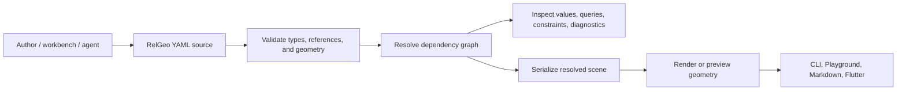

# Expected Geometry Capability Catalog

**Status:** expected catalog defined; audit, reconciliation, status matrix, dan gap backlog adalah artefak downstream terpisah

**Compatibility line:** RelGeo DSL `0.5`

**Owner keputusan:** Agus Made

**Owner katalog:** `relgeo/workspace`

**Normative source utama:** `relgeo/spec`, khususnya `spec/id/geometry/`,
`spec/id/syntax/`, dan `spec/id/core/`

## 1. Tujuan dan aturan baca

Dokumen ini mendefinisikan capability geometry yang **seharusnya tersedia**
untuk user journey RelGeo, walaupun sebagian capability belum pernah
diimplementasikan atau belum mempunyai evidence. Katalog ini disusun sebelum
audit implementasi.

### Boundary surface dan hierarki sumber

Katalog ini memakai dua boundary yang harus tetap terpisah:

1. **Product geometry contract:** perilaku geometry yang dibutuhkan author,
   reviewer, workbench, CLI/CI, dan consumer integrator pada compatibility line
   DSL `0.5`.
2. **Geometry package owner:** `geometry/` (`relgeo/geometry`) adalah library
   analitik 2D tingkat bawah dan npm API. Ia bukan source of truth DSL, bukan
   pemilik UI/menu, dan bukan pemilik command CLI. Runtime core, renderer, CLI,
   Flutter, dan workspace fixtures memiliki boundary consumer/evidence masing-
   masing.

Pemisahan ini membuat capability tetap expected pada product contract meskipun
belum ada implementasi pada package geometry, atau implementasinya dimiliki
consumer lain. Contoh capability yang sengaja tidak dihapus dari katalog
karena belum terbukti oleh package low-level adalah typed evaluator/units
(`GEO-MEASURE-001`–`005`), placement dan collections (`GEO-PLACE-*`,
`GEO-COLL-*`), structured constraint diagnostics (`GEO-CONSTRAINT-002`),
canonical serialization (`GEO-SER-002`), dan Flutter semantic parity
(`GEO-PARITY-*`). Semua row tersebut tetap harus dibandingkan oleh audit
downstream; `PENDING-AUDIT` bukan klaim bahwa implementasi sudah ada.

Discovery minimum untuk katalog ini mengikuti capability-map protocol dan
ledger: contract/normative intent, source/public API, tests/fixtures,
consumer/UI/command wiring, platform/runtime boundary, delivery, serta
ownership/documentation. Hasil discovery dipakai untuk menetapkan expectation
dan scope; hasil implementation/evidence status baru ditulis pada audit dan
reconciliation sesudah katalog ini.

Setiap row memiliki ID stabil, outcome pengguna, dasar requirement, keputusan
scope, owner/source of truth, dan status verifikasi. `PENDING-AUDIT` berarti
belum dibandingkan dengan source implementation, test, atau matrix lama; ini
bukan klaim bahwa capability sudah atau belum tersedia.

Aturan pemisahan:

- `spec/id/` menetapkan makna normatif DSL.
- master plan, Flutter alignment plan, compatibility policy, dan fixture
  manifest menetapkan workflow consumer, boundary, prioritas, dan provenance.
- kode serta matrix/audit capability lama **bukan sumber daftar awal**. Keduanya
  hanya boleh dipakai setelah katalog ini disepakati, sebagai input audit
  observasional terpisah.

## 2. Target pengguna dan workflow produk

Target pengguna yang dilayani katalog ini:

- author technical drawing dan parametric designer;
- reviewer/auditor yang perlu membaca relasi, nilai, dan diagnostics;
- pengguna browser/desktop workbench;
- pengguna shell/CI yang memvalidasi, me-resolve, dan mengompilasi dokumen;
- integrator consumer TypeScript, Flutter, renderer, dan tooling.

Workflow expected yang menjadi boundary capability:

Menu/command outcomes yang harus dapat dilayani oleh geometry contract adalah
`info`, `compile`, `check`/`validate`, output `json`/`svg`/`graph`, serta
parameterisasi `--profile`, `--param`, `--unit`, dan `--sheet`. Command tersebut
adalah consumer workflow; ia tidak mengubah source of truth geometry.

## 3. Requirement dan keputusan scope

### 3.1 Evidence discovery yang membentuk expected set

| Sumber keputusan | Apa yang diambil untuk katalog | Evidence yang diperiksa |
| --- | --- | --- |
| User journeys dan target users | Author membuat geometry parametrik; reviewer/CI membaca relasi dan diagnostics; workbench/browser melihat preview; shell/CI mengompilasi dan memvalidasi; integrator memakai semantic output | `docs/MATURATION-MASTER-PLAN.md` §1–§2.3; `geometry/README.md` |
| Workflows dan menus/commands | Geometry contract harus melayani `info`, `compile`, `check`/`validate`, output `json`/`svg`/`graph`, serta parameter `--profile`, `--param`, `--unit`, `--sheet`; command ownership tetap pada CLI/consumer | `docs/MATURATION-MASTER-PLAN.md` §2.5–§2.7 dan §5; `docs/capability-map/SURFACE-DISCOVERY-LEDGER.md` kategori `C` |
| Roadmap dan promotion decisions | Compatibility line `0.5.x`, shared fixtures, boolean/intersection fixture 15 yang active pada boundary terbatas, evaluator/unit fixture 16 yang masih candidate, dan Flutter non-publishable | `docs/MATURATION-MASTER-PLAN.md` §3–§6; `docs/plans/06-flutter-alignment.md`; `docs/plans/07-flutter-capability-promotion-and-svg-parity.md` |
| Contracts dan normative semantics | Object model, primitives, transforms, placement, anchors, collections, queries, constraints, booleans, errors, determinism, units, and types | `spec/id/core/`, `spec/id/syntax/`, `spec/id/geometry/`; `docs/compatibility-matrix.json` |
| Scope, ownership, dan inventory rules | `geometry/` adalah analytic library/npm API; spec adalah language source of truth; matrix lama dan code tidak boleh menjadi daftar expected; implementation/evidence/parity/scope harus dilaporkan terpisah | `docs/REPOSITORY-MAP.md` §Capability inventory boundary dan §Source of truth; `docs/capability-map/INVENTORY-PROTOCOL.md`; `docs/capability-map/README.md` |
| Geometry package boundary | Low-level analytic operations, path math, intersection, and shape utilities are owned by the package; package source/tests identify ownership and audit targets, not the expected catalog itself | `geometry/README.md`; `geometry/package.json`; `geometry/src/`; `geometry/src/__tests__/` |

Dengan demikian, catalog rows adalah expected product capabilities yang
surface-scoped, sementara `geometry/` source/test evidence hanya membantu
menentukan owner dan boundary yang akan diaudit. Capability yang belum ada,
belum dipromosikan, atau belum dapat diverifikasi tetap dipertahankan sebagai
row expected dengan status implementasi terpisah pada downstream artifacts.

| Kode | Requirement / keputusan | Evidence |
| --- | --- | --- |
| `R-DRAW` | Pengguna dapat membuat dan memodifikasi geometri 2D parametrik dengan relasi yang dapat dibaca. | `docs/MATURATION-MASTER-PLAN.md` §2.3–2.5, §3.1–3.2; `spec/id/core/01-overview.md`; `spec/id/geometry/` |
| `R-RELATE` | Placement, anchors, queries, dan constraints harus menyatakan hubungan secara eksplisit. | `spec/id/core/05-semantic-guarantees.md`; `spec/id/geometry/17-placement.md`, `18-anchors.md`, `20-geometry-queries.md`, `21-constraints.md` |
| `R-PARAM` | Nilai typed, unit, parameter, constant, derived value, dan expression harus dapat dipakai ulang tanpa coercion ambigu. | `spec/id/syntax/07-type-system.md`, `08-parameters.md`, `09-constants.md`, `10-derived.md`, `12-expressions.md` |
| `R-COLLECTION` | Pengguna dapat membuat pola, membagi lintasan, mengakses hasil multi-object, dan mempertahankan urutan yang stabil. | `spec/id/geometry/16-collection-objects.md`, `19-collections.md` |
| `R-OPS` | Pengguna dapat melakukan transform dan operasi geometry yang menghasilkan object baru atau result collection yang dapat dirujuk lagi. | `spec/id/geometry/15-composition-objects.md`, `16-collection-objects.md` |
| `R-BOOL` | Closed shape dapat di-intersect/subtract dan menghasilkan hasil single atau multi dengan error behavior eksplisit. | `spec/id/geometry/16-collection-objects.md`; `docs/plans/07-flutter-capability-promotion-and-svg-parity.md` §5; fixture IDs `v05-boolean-intersection-candidate`, `v05-runtime-empty-boolean`, `v05-runtime-multipart-boolean` |
| `R-ROBUST` | Hasil yang sama harus deterministic lintas platform, toleran terhadap floating point, dan tidak bergantung pada winding input. | `spec/id/core/05-semantic-guarantees.md`; `spec/id/geometry/13-object-model.md`, `19-collections.md` |
| `R-CONTRACT` | Contract line, owner, compatibility, dan evidence consumer dipisahkan dari implementation status. | `docs/MATURATION-MASTER-PLAN.md` §2.1–2.7; `docs/compatibility-matrix.json`; `fixtures/manifest.json` |
| `R-PARITY` | TypeScript dan Flutter membandingkan semantic geometry pada boundary yang disepakati, tanpa menganggap raw SVG bytes sebagai parity contract. | `docs/plans/06-flutter-alignment.md` §1–§8; `docs/plans/07-flutter-capability-promotion-and-svg-parity.md` §2–§7; `fixtures/manifest.json` |

Scope decisions yang berlaku untuk katalog ini:

- **IN:** geometry 2D declarative, typed dimensions, explicit relations,
  path-like/closed-shape operations, structured diagnostics, deterministic
  serialization, dan semantic parity.
- **IN WITH BOUNDARY:** constraint adalah validator pasca-resolve, bukan
  general solver; boolean single/multi mengikuti result mode; Flutter adalah
  workbench non-publishable dan parity dibatasi oleh fixture/semantic contract.
- **OUT:** general bidirectional constraint solving, implicit relation
  inference, byte-for-byte SVG equality, Flutter menjadi dependency runtime
  TypeScript, dan mobile release gate yang ditunda oleh keputusan scope.

## 4. Expected capability catalog

### A. Object model dan primitives

| ID | Capability | User outcome | Dasar requirement | Scope decision | Owner / source of truth | Status verifikasi |
| --- | --- | --- | --- | --- | --- | --- |
| `GEO-OBJ-001` | Object identity, explicit type, dependency graph, dan topological evaluation | Author dapat memberi nama object, mereferensikannya, dan memperoleh hasil tanpa bergantung pada urutan penulisan | `R-DRAW`, `R-RELATE`, `R-ROBUST` | **IN**; identity global per document, duplicate/cycle menjadi diagnostic | `relgeo/spec`; `spec/id/geometry/13-object-model.md`, `spec/id/core/04-evaluation-order.md` | `PENDING-AUDIT` |
| `GEO-PRIM-001` | Point dan line, termasuk absolute/relative point, from-to, direction-length, dan tangent line | Pengguna dapat membangun titik dan garis dasar dari koordinat, relasi, arah, atau tangent | `R-DRAW`, `R-RELATE` | **IN**; line standalone memakai arah kardinal, angle bebas melalui point/path contract | `relgeo/spec`; `spec/id/geometry/14-geometry-objects.md` §14.1–14.2 | `PENDING-AUDIT` |
| `GEO-PRIM-002` | Rect, circle, dan ellipse dengan size/radius, property, anchors, holes, dan ClosedShape surface | Pengguna dapat membuat panel, lubang, ring, dan bentuk oval yang dapat diukur atau dioperasikan | `R-DRAW`, `R-BOOL` | **IN**; ellipse `size` tidak boleh bercampur dengan `rx`/`ry`; radius positif | `relgeo/spec`; `spec/id/geometry/14-geometry-objects.md` §14.3–14.5 | `PENDING-AUDIT` |
| `GEO-PRIM-003` | Arc, quadratic, dan cubic path segment | Pengguna dapat membuat kurva terbuka dengan endpoint, length, dan traversal | `R-DRAW`, `R-RELATE` | **IN**; degenerate arc dan invalid control data harus terdeteksi | `relgeo/spec`; `spec/id/geometry/14-geometry-objects.md` §14.6–14.8 | `PENDING-AUDIT` |
| `GEO-PRIM-004` | Path, polygon, dan text geometry dengan chaining, close, holes, corner processing, dan label placement | Pengguna dapat membuat outline kompleks, bentuk tertutup, dan label yang dapat dirender | `R-DRAW`, `R-RELATE` | **IN**; path terbuka/tertutup dan `path-ref` harus dibedakan secara typed | `relgeo/spec`; `spec/id/geometry/14-geometry-objects.md` §14.9–14.11 | `PENDING-AUDIT` |
| `GEO-PRIM-005` | Composition objects: group, clone, component, parameters/exports, dan namespace instance | Pengguna dapat reuse geometry tanpa kehilangan identity atau scope | `R-DRAW`, `R-PARAM` | **IN**; component internals mengikuti scope; clone memiliki identity baru | `relgeo/spec`; `spec/id/geometry/15-composition-objects.md` §15.1–15.3 | `PENDING-AUDIT` |

### B. Dimensions, units, dan evaluator

| ID | Capability | User outcome | Dasar requirement | Scope decision | Owner / source of truth | Status verifikasi |
| --- | --- | --- | --- | --- | --- | --- |
| `GEO-MEASURE-001` | Typed dimensions: length, number, angle, percent, point, vector, frame2d, bbox2d, path-ref, ClosedShape, dan collection | Author mendapat error yang jelas ketika nilai dipakai pada konteks geometry yang salah | `R-PARAM`, `R-RELATE` | **IN**; no broad implicit coercion | `relgeo/spec`; `spec/id/syntax/07-type-system.md` | `PENDING-AUDIT` |
| `GEO-MEASURE-002` | Scene unit, explicit unit literal, unit normalization, dan conversion termasuk `mm`, `cm`, `m`, `in`, `px` boundary | Dokumen dapat dipindahkan antar unit tanpa mengubah makna geometry | `R-PARAM`, `R-CONTRACT` | **IN WITH BOUNDARY**; unitless number menjadi length hanya pada context yang mengharapkannya; evaluator/unit candidate tetap decision boundary | `relgeo/spec`; `spec/id/syntax/07-type-system.md`; `docs/plans/06-flutter-alignment.md` §5–§6; fixture `v05-evaluator-units-candidate` | `PENDING-AUDIT` |
| `GEO-MEASURE-003` | Arithmetic, comparison, logical, ternary, math functions, dan string formatting yang side-effect free | Author dapat menurunkan ukuran, memilih konfigurasi, dan membuat label secara repeatable | `R-PARAM`, `R-DRAW` | **IN**; expression harus deterministic dan type-safe | `relgeo/spec`; `spec/id/syntax/12-expressions.md` | `PENDING-AUDIT` |
| `GEO-MEASURE-004` | Typed parameters, defaults, structured params, constants, derived values, dan local component derived scope | Pengguna dapat mengubah input utama dan membiarkan nilai/geometry turunan diperbarui | `R-PARAM` | **IN**; derived dependency cycle ditolak; component local scope tidak global | `relgeo/spec`; `spec/id/syntax/08-parameters.md`, `09-constants.md`, `10-derived.md` | `PENDING-AUDIT` |
| `GEO-MEASURE-005` | Deterministic validation of units, types, references, expressions, and required fields | Reviewer/CI dapat membedakan structural, schema, reference, expression, dependency, dan geometry failure | `R-CONTRACT`, `R-ROBUST` | **IN**; stable error code dan document path wajib dipertahankan | `relgeo/spec`; `spec/id/core/06-error-model.md` §6.1–§6.7; `fixtures/manifest.json` invalid fixtures | `PENDING-AUDIT` |

### C. Transforms, placement, dan anchors

| ID | Capability | User outcome | Dasar requirement | Scope decision | Owner / source of truth | Status verifikasi |
| --- | --- | --- | --- | --- | --- | --- |
| `GEO-XFORM-001` | Post-geometry transform pipeline: ordered translate, rotate, scale, mirror, explicit/default origin | Pengguna dapat mengubah pose object/group/clone dengan urutan operasi yang dapat diprediksi | `R-OPS`, `R-RELATE` | **IN**; post-resolve transform tidak membuat identity baru; default origin adalah bbox center | `relgeo/spec`; `spec/id/geometry/13-object-model.md`, `15-composition-objects.md` §15.5 | `PENDING-AUDIT` |
| `GEO-XFORM-002` | Geometry operation objects `mirror`, `rotate`, `scale`, `translate`, `reverse`, `split` | Pengguna dapat membuat geometry result baru yang dapat dipakai ulang oleh object berikutnya | `R-OPS` | **IN**; operation result adalah node dependency baru; split terbuka memakai `first/last` atau collection dua bagian | `relgeo/spec`; `spec/id/geometry/15-composition-objects.md` §15.4; `spec/id/core/06-error-model.md` §6.3 | `PENDING-AUDIT` |
| `GEO-PLACE-001` | Anchor-based `place`: scalar, point, multi-anchor, offset, `inside` + margin | Pengguna dapat menempatkan object relatif terhadap geometry lain tanpa menghitung koordinat manual | `R-RELATE` | **IN WITH BOUNDARY**; placement tidak mengubah dimensi; `inside` hanya container rect | `relgeo/spec`; `spec/id/geometry/17-placement.md` §17.1 | `PENDING-AUDIT` |
| `GEO-PLACE-002` | Path placement `on.point`, `on.path`, dan `on.frame` dengan parameter `t` dan anchor | Pengguna dapat menaruh marker atau object mengikuti lintasan, dengan orientasi optional | `R-RELATE`, `R-DRAW` | **IN**; `on.path` mempertahankan orientasi, `on.frame` mengikuti tangent | `relgeo/spec`; `spec/id/geometry/17-placement.md` §17.2–17.4 | `PENDING-AUDIT` |
| `GEO-ANCH-001` | Standard point, scalar, direction, dan primitive-specific anchors | Author dapat merujuk `center`, edges, endpoints, tangent, dan normal tanpa hard-code coordinate | `R-RELATE` | **IN**; standard 9-point, horizontal/vertical scalar, dan direction anchors memiliki tipe stabil | `relgeo/spec`; `spec/id/geometry/18-anchors.md` | `PENDING-AUDIT` |
| `GEO-ANCH-002` | Custom named anchors dan stable anchors pada operation results | Component/author dapat mengekspos titik relasional yang bermakna domain dan tetap addressable setelah operation | `R-RELATE`, `R-OPS` | **IN**; custom anchor dievaluasi sebagai reference; operation result minimal punya bbox anchors stabil | `relgeo/spec`; `spec/id/geometry/18-anchors.md`; `spec/id/geometry/15-composition-objects.md` §15.4 | `PENDING-AUDIT` |

### D. Collections dan pattern generation

| ID | Capability | User outcome | Dasar requirement | Scope decision | Owner / source of truth | Status verifikasi |
| --- | --- | --- | --- | --- | --- | --- |
| `GEO-COLL-001` | Repeat modes: linear, each, grid, polar, dan along | Pengguna dapat membuat pola lubang/vent/marker tanpa menduplikasi source object | `R-COLLECTION`, `R-RELATE` | **IN**; context variables dan identity index harus stabil | `relgeo/spec`; `spec/id/geometry/16-collection-objects.md` §16.1 | `PENDING-AUDIT` |
| `GEO-COLL-002` | Along distribution: uniform-length, uniform-t, fixed-distance, offsets, closed-path endpoint rule, dan frame context | Pengguna dapat mendistribusikan item dengan jarak atau parameter yang dipilih sepanjang path | `R-COLLECTION`, `R-RELATE` | **IN WITH BOUNDARY**; fixed-distance menurunkan count; conflicting manual placement ditolak | `relgeo/spec`; `spec/id/geometry/16-collection-objects.md` §16.1; `spec/id/core/06-error-model.md` §6.8 | `PENDING-AUDIT` |
| `GEO-COLL-003` | Grid pitch/gap auto-layout dan validation of over-constrained item placement | Pengguna dapat membuat grid seragam atau edge-to-edge dengan aturan conflict yang eksplisit | `R-COLLECTION`, `R-ROBUST` | **IN**; `pitch` dan `gap` mutually exclusive; collection-level placement tetap legal | `relgeo/spec`; `spec/id/geometry/16-collection-objects.md` §16.1; `spec/id/core/06-error-model.md` §6.8 | `PENDING-AUDIT` |
| `GEO-COLL-004` | Divide to `collection<point>`, split result collection, indexing, `count`, `first`, `last` | Pengguna dapat memakai hasil pembagian sebagai input geometry atau repeat berikutnya | `R-COLLECTION`, `R-OPS` | **IN**; traversal order mengikuti target; split tanpa `pick` selalu dua bagian pada boundary aktif | `relgeo/spec`; `spec/id/geometry/16-collection-objects.md` §16.2–16.3, `19-collections.md` | `PENDING-AUDIT` |
| `GEO-COLL-005` | Stable collection ordering and repeat identity | Rendering, references, and indexed access tetap reproducible pada input yang sama | `R-COLLECTION`, `R-ROBUST` | **IN**; no unordered runtime exposure | `relgeo/spec`; `spec/id/geometry/19-collections.md` §19.5; `spec/id/core/05-semantic-guarantees.md` | `PENDING-AUDIT` |

### E. Queries dan intersections

| ID | Capability | User outcome | Dasar requirement | Scope decision | Owner / source of truth | Status verifikasi |
| --- | --- | --- | --- | --- | --- | --- |
| `GEO-QUERY-001` | Measurement queries: `distance`, `length`, `perimeter`, `area`, `bbox`, `width`, `height`, `minX`, `maxX`, `minY`, `maxY` | Pengguna dapat mengukur dan menurunkan layout dari geometry dunia yang sudah resolved | `R-RELATE`, `R-DRAW` | **IN**; bbox adalah `bbox2d` record, bukan object placeable; perimeter boleh deterministic approximation | `relgeo/spec`; `spec/id/geometry/20-geometry-queries.md` §20.1–20.8; `spec/id/syntax/07-type-system.md` | `PENDING-AUDIT` |
| `GEO-QUERY-002` | Point/vector/path queries: `midpoint`, `polar`, `angleBetween`, `pointAt`, `tangentAt`, `normalAt` | Pengguna dapat membuat titik turunan dan orientasi lokal pada lintasan | `R-RELATE`, `R-PARAM` | **IN**; `angleBetween` v0.5 hanya point-to-point; `t` berada pada `[0,1]` | `relgeo/spec`; `spec/id/geometry/20-geometry-queries.md` §20.7–20.13 | `PENDING-AUDIT` |
| `GEO-QUERY-003` | Spatial queries `closestPoint`, `project`, `reflect`, `toWorld`, `toLocal` | Pengguna dapat mengaitkan titik ke garis/objek dan berpindah antar coordinate space | `R-RELATE` | **IN WITH BOUNDARY**; target overload dibatasi sesuai v0.5 type contract | `relgeo/spec`; `spec/id/geometry/20-geometry-queries.md` §20.14–20.17 | `PENDING-AUDIT` |
| `GEO-QUERY-004` | Parametric intersection query dengan selector `first`, `last`, `nearest`, `farthest`, `index` dan single/multi result context | Pengguna dapat membuat crossing point, split point, atau memilih intersection deterministically | `R-BOOL`, `R-RELATE`, `R-COLLECTION` | **IN**; no silent choice when multiple intersections require explicit selector | `relgeo/spec`; `spec/id/geometry/20-geometry-queries.md` §20.18; `spec/id/core/06-error-model.md` §6.2; fixture `v05-boolean-intersection-candidate` | `PENDING-AUDIT` |
| `GEO-QUERY-005` | `frameAt` dan `tAtLength` sebagai surface orientasi/distribusi lintasan | `on.frame` dan `repeat.along` dapat berbagi semantics frame dan length traversal | `R-RELATE`, `R-COLLECTION` | **IN**; frame read-only dengan point/angle/tangent/normal | `relgeo/spec`; `spec/id/geometry/20-geometry-queries.md` §20.19–20.20 | `PENDING-AUDIT` |

### F. Constraints dan diagnostics

| ID | Capability | User outcome | Dasar requirement | Scope decision | Owner / source of truth | Status verifikasi |
| --- | --- | --- | --- | --- | --- | --- |
| `GEO-CONSTRAINT-001` | Constraint validation untuk `equal`, `parallel`, `perpendicular`, dan `tangent` | Reviewer/CI dapat memeriksa apakah relasi geometry yang sudah dibentuk terpenuhi | `R-RELATE`, `R-ROBUST` | **IN**; validasi dilakukan setelah geometry resolve | `relgeo/spec`; `spec/id/geometry/21-constraints.md` §21.1–21.5 | `PENDING-AUDIT` |
| `GEO-CONSTRAINT-002` | Post-resolve structured violations, stable path/code, dan no-general-solver policy | Workbench/CLI dapat menampilkan violation tanpa diam-diam mengubah geometry | `R-CONTRACT`, `R-ROBUST` | **IN WITH BOUNDARY**; `CONSTRAINT_VIOLATION` dapat menjadi warning/failure di layer caller; bukan simultaneous solver | `relgeo/spec`; `spec/id/geometry/21-constraints.md` §21.6; `spec/id/core/05-semantic-guarantees.md` §5.6, `06-error-model.md` §6.6; fixture `v05-runtime-align-violation` | `PENDING-AUDIT` |

### G. Boolean operations dan closed-shape results

| ID | Capability | User outcome | Dasar requirement | Scope decision | Owner / source of truth | Status verifikasi |
| --- | --- | --- | --- | --- | --- | --- |
| `GEO-BOOLEAN-001` | ClosedShape boolean `union`, `subtract`, `intersect`, dan `xor` | Pengguna dapat membuat overlap, cutout, union, dan perubahan topology dari shapes | `R-BOOL`, `R-DRAW` | **IN**; operands harus ClosedShape 2D; output dapat menjadi ClosedShape atau collection | `relgeo/spec`; `spec/id/geometry/16-collection-objects.md` §16.4 | `PENDING-AUDIT` |
| `GEO-BOOLEAN-002` | Boolean result mode `single`/`multi`, holes/topology, and explicit empty/multipart behavior | Pengguna dapat memilih contract output dan menerima error yang dapat ditindaklanjuti saat mode tidak cocok | `R-BOOL`, `R-CONTRACT` | **IN WITH BOUNDARY**; active promotion hanya boundary boolean/intersection fixture 15; evaluator/unit fixture 16 tetap candidate | `relgeo/spec` untuk semantics; `relgeo/workspace` untuk fixtures/provenance; `docs/plans/07-flutter-capability-promotion-and-svg-parity.md` §5; `fixtures/manifest.json` | `PENDING-AUDIT` |

### H. Numerical robustness dan deterministic behavior

| ID | Capability | User outcome | Dasar requirement | Scope decision | Owner / source of truth | Status verifikasi |
| --- | --- | --- | --- | --- | --- | --- |
| `GEO-NUM-001` | Consistent epsilon/tolerance for geometric equality and membership tests | Hasil intersection, split, constraint, dan comparison tidak rapuh terhadap raw float equality | `R-ROBUST` | **IN**; tolerance policy harus konsisten dan terdokumentasi per boundary | `relgeo/spec`; `spec/id/core/05-semantic-guarantees.md` §5.5; `spec/id/geometry/14-geometry-objects.md` path comparison note | `PENDING-AUDIT` |
| `GEO-NUM-002` | Winding-independent closed-shape normalization dan stable holes/even-odd semantics | Bentuk clockwise/counter-clockwise menghasilkan area/offset/holes yang setara | `R-BOOL`, `R-ROBUST` | **IN**; normalization dilakukan sebelum operation yang memerlukannya | `relgeo/spec`; `spec/id/core/05-semantic-guarantees.md` §5.5 | `PENDING-AUDIT` |
| `GEO-NUM-003` | Degenerate geometry, invalid radius/path/join/offset/tangent/split detection dengan error code stabil | Author mendapat kegagalan yang jelas daripada geometry korup atau hasil diam-diam | `R-ROBUST`, `R-CONTRACT` | **IN**; invalid input tidak boleh diproyeksikan/diubah diam-diam untuk memenuhi operation | `relgeo/spec`; `spec/id/core/06-error-model.md` §6.2–§6.9 | `PENDING-AUDIT` |
| `GEO-DET-001` | Deterministic resolution independent of platform, parse order, time, randomness, dan global mutable state | Input source yang sama selalu menghasilkan scene dan diagnostics yang sama | `R-ROBUST`, `R-CONTRACT` | **IN**; resolver harus pure terhadap document context | `relgeo/spec`; `spec/id/core/05-semantic-guarantees.md` §5.1, `12-expressions.md` §12.8 | `PENDING-AUDIT` |
| `GEO-DET-002` | Stable object identity, dependency ordering, operation result anchors, collection order, dan error paths | Reference, indexing, snapshots, dan reviewer navigation tidak berubah-ubah | `R-RELATE`, `R-COLLECTION`, `R-ROBUST` | **IN**; no resolver-generated rename atau unordered result exposure | `relgeo/spec`; `spec/id/core/05-semantic-guarantees.md` §5.2–5.4; `spec/id/geometry/13-object-model.md`, `19-collections.md` | `PENDING-AUDIT` |

### I. Serialization dan semantic parity

| ID | Capability | User outcome | Dasar requirement | Scope decision | Owner / source of truth | Status verifikasi |
| --- | --- | --- | --- | --- | --- | --- |
| `GEO-SER-001` | Resolved scene serialization yang mempertahankan object identity/type, primitive/path geometry, anchors/properties, collections, dan diagnostics | CLI, inspector, renderer, dan downstream tooling dapat membaca hasil resolve tanpa mengulang semantics | `R-CONTRACT`, `R-PARITY` | **IN**; JSON scene adalah semantic projection, bukan dump internal yang tidak stabil | `relgeo/spec` untuk semantics; `relgeo/workspace` untuk expected fixtures; `fixtures/manifest.json` expected resolved snapshots | `PENDING-AUDIT` |
| `GEO-SER-002` | Stable geometry serialization ordering and canonical numeric representation | Snapshot/review diff menunjukkan perubahan semantics, bukan noise akibat order atau float formatting | `R-ROBUST`, `R-CONTRACT` | **IN**; canonicalization harus terpisah dari renderer-specific style | `relgeo/workspace` sebagai fixture/evidence owner; `spec/id/core/05-semantic-guarantees.md`; `docs/plans/07-flutter-capability-promotion-and-svg-parity.md` §3–§7 | `PENDING-AUDIT` |
| `GEO-PARITY-001` | Shared fixture semantic parity antara TypeScript consumers dan Flutter untuk object/primitive/path geometry | Input DSL yang sama memberi geometry semantics yang dapat dibandingkan lintas consumer | `R-PARITY`, `R-CONTRACT` | **IN WITH BOUNDARY**; fixture 15 boolean/intersection active pada boundary disetujui; fixture 16 evaluator/unit tetap capability/candidate | `relgeo/workspace` untuk `fixtures/manifest.json` dan expected snapshots; `docs/plans/06-flutter-alignment.md`, `07-flutter-capability-promotion-and-svg-parity.md` | `PENDING-AUDIT` |
| `GEO-PARITY-002` | Semantic SVG projection parity untuk object/primitive/path geometry dengan tolerance | Preview dan renderer berbeda platform tetap dapat dinilai setara secara geometry | `R-PARITY`, `R-ROBUST` | **IN WITH BOUNDARY**; compare semantic anchors/object paths; raw SVG bytes, style, viewBox, dan full presentation bukan contract aktif | `relgeo/workspace` + `relgeo/flutter` evidence policy; `docs/plans/06-flutter-alignment.md` §2, §6; `docs/plans/07-flutter-capability-promotion-and-svg-parity.md` §2–§7 | `PENDING-AUDIT` |

## 5. Fixture dan provenance boundary

Manifest dipakai untuk memetakan evidence dan keputusan promotion setelah
katalog, bukan untuk menemukan daftar awal capability:

| Fixture/provenance | Peran dalam katalog expected | Scope decision |
| --- | --- | --- |
| `v05-relational-baseline` | baseline consumer untuk rect/circle/polygon/text, anchors, dan relational scene | active v0.5 baseline |
| `v05-runtime-align-violation` | structured post-resolve constraint diagnostic | runtime-diagnostic; tidak mengubah geometry contract menjadi solver |
| `v05-boolean-intersection-candidate` | intersection point dan boolean intersect/subtract semantic projection | active hanya pada boundary boolean/intersection yang disetujui |
| `v05-evaluator-units-candidate` | parameter length, `in`/`mm`, derived placement, scalar evaluator | capability/candidate; bukan active parity baseline |
| `v05-runtime-empty-boolean`, `v05-runtime-multipart-boolean` | empty/multipart result error behavior | runtime-error boundary |
| invalid fixtures `11`, `12`, `13`, `17`, `18` | missing type, YAML syntax, unknown reference, unsupported future versions | expected negative contract |

`fixtures/manifest.json` menetapkan `relgeo/workspace` sebagai canonical owner,
child repository sebagai standalone-local-test consumer, dan workspace runner
sebagai integration authority. Itu adalah provenance decision; status
implementasi setiap row tetap menunggu audit.

## 6. Historical gate sebelum audit implementasi

Gate pre-audit berikut telah dipenuhi sebelum audit dimulai:

1. ID, boundary, dan scope exclusions ditetapkan di atas;
2. audit terpisah memetakan setiap ID ke implementation status, evidence,
   parity, dan verification status;
3. audit tidak menghapus row hanya karena source atau matrix lama belum
   menemukannya;
4. serialization canonicalization, tolerance policy, dan evaluator/unit
   promotion diperlakukan sebagai keputusan eksplisit bila evidence belum cukup.

Downstream audit yang sengaja **tidak** dipakai sebagai source daftar awal:

- `docs/capability-map/geometry/capability-matrix.md`;
- `docs/capability-map/geometry/archive/implementation-audit-legacy.md`;
- source files di `geometry/`.

## 7. Source register wajib

- [`docs/MATURATION-MASTER-PLAN.md`](../../MATURATION-MASTER-PLAN.md)
- [`docs/REPOSITORY-MAP.md`](../../REPOSITORY-MAP.md)
- [`docs/capability-map/INVENTORY-PROTOCOL.md`](../INVENTORY-PROTOCOL.md)
- [`docs/capability-map/SURFACE-DISCOVERY-LEDGER.md`](../SURFACE-DISCOVERY-LEDGER.md)
- [`docs/capability-map/README.md`](../README.md)
- [`geometry/README.md`](../../../geometry/README.md)
- [`geometry/package.json`](../../../geometry/package.json)
- [`docs/compatibility-matrix.json`](../../compatibility-matrix.json)
- [`docs/plans/06-flutter-alignment.md`](../../plans/06-flutter-alignment.md)
- [`docs/plans/07-flutter-capability-promotion-and-svg-parity.md`](../../plans/07-flutter-capability-promotion-and-svg-parity.md)
- [`fixtures/manifest.json`](../../../fixtures/manifest.json)
- [`spec/id/geometry/`](../../../spec/id/geometry)
- [`spec/id/syntax/`](../../../spec/id/syntax)
- [`spec/id/core/`](../../../spec/id/core)

**Downstream artifacts:** [implementation audit](./archive/implementation-audit-legacy.md),
[reconciliation](./reconciliation.md), [status matrix](./status-matrix.md),
[implementation-gap backlog](./implementation-gap-backlog.md), dan
[coverage validation handoff](./coverage-validation-handoff.md).
