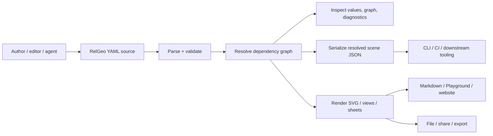

# Expected Language-Specification Capability Catalog

**Status:** expected baseline selesai; audit implementasi tersedia sebagai artefak downstream
**Compatibility line:** RelGeo DSL `0.5`
**Owner keputusan:** Agus Made
**Owner katalog:** `relgeo/workspace`
**Normative source utama:** `relgeo/spec`, khususnya `spec/id/`

Artefak turunan yang menjaga pemisahan expected-versus-observed:

- [implementation audit](./implementation-audit.md)
- [expected-versus-observed reconciliation](./reconciliation.md)
- [status matrix](./status-matrix.md)
- [implementation-gap backlog](./implementation-gap-backlog.md)

## 1. Tujuan dan aturan baca

Dokumen ini adalah katalog **expected capability** untuk kontrak bahasa RelGeo.
Daftar ini disusun dari kebutuhan pengguna, workflow produk, surface command,
roadmap/scope decision, dan kontrak normatif `spec/` sebelum membandingkannya
dengan kode atau matrix capability lama.

Katalog ini bukan laporan bahwa capability telah diimplementasikan. Kolom
`Status verifikasi` tetap sengaja bernilai `PENDING-AUDIT` sebagai penanda bahwa
expected catalog bukan observed-status matrix, termasuk setelah audit berjalan.
Status implementation/evidence yang sudah diamati dicatat terpisah dalam audit,
reconciliation, status matrix, dan backlog; audit tidak boleh menghapus
capability yang belum ada dari katalog expected.

Setiap row memiliki ID stabil dan enam atribut yang diperlukan untuk audit:
outcome pengguna, dasar requirement, keputusan scope, owner/source of truth, dan
status verifikasi.

### Audit handoff saat ini

Audit terhadap seluruh 53 ID telah dilakukan dan join satu-ke-satu tersedia di
[`reconciliation.md`](./reconciliation.md). Expected rows tetap `PENDING-AUDIT`
secara sengaja; observed status saat ini berada di
[`status-matrix.md`](./status-matrix.md): **16 `✔️` · 36 `🌗` · 0 `❌` · 0
`➖` · 0 `⏸️` · 1 `⚠️`**.

Bounded implementation tranche yang aktif hanya mencakup `GAP-001`, `GAP-009`,
`GAP-011`, dan `GAP-013`. Local verification untuk tranche tersebut tercatat di
[`implementation-audit.md`](./implementation-audit.md), termasuk package tests,
consumer tests/builds, vocabulary check, dan conformance `260/260`. Ini tidak
mengubah expected ownership: `spec/id/` tetap normative source of truth, dan
Node 24 CI, public/browser/native-host evidence, publishing, serta deployment
tetap bukan prerequisite.

### 1.1 Evidence boundary used to build the expected catalog

Katalog ini sengaja dibangun dari expectation sources berikut. `spec/id/` adalah
source of truth semantik; dokumen workspace menetapkan boundary, roadmap, dan
keputusan scope; capability-map menetapkan metode discovery dan pemisahan
expected-versus-observed. Tidak ada row yang dihapus hanya karena source,
test, consumer, atau evidence implementasinya belum ditemukan.

| Evidence class | Yang ditetapkan untuk katalog | Evidence yang dipakai |
| --- | --- | --- |
| Normative contract | Struktur dokumen, tipe, evaluasi, geometry, presentation, diagnostics, dan compatibility line | [`spec/id/README.md`](../../../spec/id/README.md), seluruh bab `spec/id/core/`, `syntax/`, `geometry/`, dan `presentation/` |
| Surface and ownership | `spec` sebagai pemilik kontrak; CLI, Markdown, Playground, website, Flutter, dan MCP sebagai consumer/boundary | [`docs/REPOSITORY-MAP.md`](../../REPOSITORY-MAP.md), terutama tabel ownership, capability inventory boundary, dan boundary MCP/Flutter |
| User journeys and target users | Markdown embedding, technical drawing, parametric drafting, human/machine review, serta author/editor, reviewer, shell/CI, workbench, dan tooling/agent users | [`relgeo.github.io/src/content/site/en/use-cases.md`](../../../relgeo.github.io/src/content/site/en/use-cases.md), [`why-relgeo.md`](../../../relgeo.github.io/src/content/site/en/why-relgeo.md), [`playground/docs/UX-UI-AUDIT-AND-PLAN.md`](../../../playground/docs/UX-UI-AUDIT-AND-PLAN.md) |
| Workflow and commands | Parse → validate → resolve → inspect → serialize/render; CLI `info`, `compile`, `check`/`validate`, output formats, profile/parameter/unit/sheet options; browser authoring flow | [`cli/docs/README.md`](../../../cli/docs/README.md), [`cli/README.md`](../../../cli/README.md), Playground UX audit, and §3 below |
| Roadmap and product scope | Compatibility line, staged conformance, public docs/Playground hardening, and agent-assisted authoring boundaries | [`docs/MATURATION-MASTER-PLAN.md`](../../MATURATION-MASTER-PLAN.md), especially §§2–7; [`docs/plans/11-mcp-agent-integration.md`](../../plans/11-mcp-agent-integration.md) |
| Scope decisions and inventory method | 2D boundary, no general solver, deferred mobile/package delivery, candidate promotion rules, and evidence/status vocabulary | [`docs/decisions/07-cross-repo-open-decisions.md`](../../decisions/07-cross-repo-open-decisions.md), [`INVENTORY-PROTOCOL.md`](../INVENTORY-PROTOCOL.md), [`SURFACE-DISCOVERY-LEDGER.md`](../SURFACE-DISCOVERY-LEDGER.md) |

### 1.2 Surface boundary

The catalog covers the language contract as consumed through these surfaces; it
does not reassign semantic ownership to those consumers.

| Surface | Expected role in this catalog | Boundary decision |
| --- | --- | --- |
| `spec` | Normative document, syntax, semantic, geometry, presentation, error, and version contract | In scope and authoritative |
| Markdown plugins / website | Embed or present source and rendered drawing | Consumer expectation; presentation is not a replacement for `spec` |
| CLI / shell / CI | Inspect, validate, resolve, graph, JSON, SVG, profile, parameter, unit, and sheet workflows | Consumer boundary; command behavior is not the language source of truth |
| Playground / Flutter workbench | Edit, preview, inspect, graph, diagnose, persist/share/export, and agent-assisted authoring workflows | Consumer boundary; UI/platform delivery is not required to define the language catalog |
| MCP / agent integration | Rule-aware read/modify workflows over document/session contracts | Separate protocol/host boundary; it must consume the language contract |

### 1.3 Expected-but-not-yet-observed capabilities are retained

`PENDING-AUDIT` means “expected catalog row whose observed implementation status
is reported downstream”; it does not mean implemented, absent, or approved by a
consumer. This keeps capabilities that are not currently proven or may be absent
from code in the expected baseline. Examples deliberately retained here are:

- `SER-001` canonical resolved-scene JSON policy, whose field/number/identity
  contract is still an explicit contract gap;
- `SER-002` layered SVG semantic output contract, while raw SVG byte equality is
  explicitly out of scope;
- `COLL-003` the full boolean family, with active compatibility limited by the
  accepted fixture/operand boundary;
- `EVAL-002` evaluator/unit normalization, including candidate evidence that is
  not automatically active; and
- `VER-004` fixture status and promotion provenance as part of compatibility
  governance.

These rows are expected because the normative spec, consumer workflows, roadmap,
or approved scope decisions require them—not because an implementation audit has
already found them. The downstream audit must preserve every ID and report an
explicit gap when implementation is absent.

## 2. Dasar requirement dan target pengguna

| Kode dasar | Requirement yang diturunkan | Sumber evidence |
| --- | --- | --- |
| `R-AUTHOR` | Author dapat menulis intent relasional yang tetap readable oleh manusia dan mesin, lalu mengubah parameter tanpa kehilangan makna. | `relgeo.github.io/src/content/site/en/why-relgeo.md`, `relgeo.github.io/src/content/site/en/use-cases.md`, `spec/id/core/01-overview.md` |
| `R-DRAWING` | Pengguna technical drawing dapat membuat geometri 2D parametrik, relasi placement, query, constraint, dimensi, dan anotasi yang deterministic. | `relgeo.github.io/src/content/site/en/use-cases.md`, `spec/id/geometry/`, `spec/id/presentation/` |
| `R-MARKDOWN` | Author Markdown dapat menyimpan source dan menampilkan drawing/preview tanpa ekspor manual sebagai gambar. | `relgeo.github.io/src/content/site/en/use-cases.md`, `docs/MATURATION-MASTER-PLAN.md` §3.1–3.2 |
| `R-SHELL` | Pengguna shell/CI dapat inspect, validate, resolve, dan compile ke JSON, SVG, atau graph, termasuk memilih profile, parameter, unit, dan sheet. | `cli/README.md`, `cli/docs/README.md` |
| `R-WORKBENCH` | Pengguna browser/desktop dapat memilih contoh, edit source, resolve, melihat preview, inspect object/graph/diagnostic, lalu share/export. | `playground/docs/UX-UI-AUDIT-AND-PLAN.md` §1 dan §4, `docs/REPOSITORY-MAP.md` |
| `R-CONTRACT` | Semua consumer mengikuti satu kontrak bahasa, version gate, error behavior, dan compatibility line yang dimiliki spec. | `docs/MATURATION-MASTER-PLAN.md` §2.3–2.4, `docs/REPOSITORY-MAP.md`, `fixtures/manifest.json` |
| `R-AGENT` | Integrasi editor/agent dapat membaca dan memodifikasi document session melalui kontrak terpisah tanpa menjadikan Flutter atau filesystem sebagai pemilik bahasa. | `docs/REPOSITORY-MAP.md` §Boundary MCP dan Flutter, `docs/plans/11-mcp-agent-integration.md` |

Target pengguna expected catalog: author Markdown, technical drawing author,
parametric designer, reviewer/auditor, shell/CI integrator, browser/desktop
workbench user, serta integrator tooling/agent. Surface tersebut adalah cara
mengkonsumsi kontrak; bukan source of truth makna bahasa.

## 3. Workflow produk yang menjadi cakupan

Menu/command expectations yang mempengaruhi bahasa adalah `info`, `compile`,
`check`/`validate`, output `json`/`svg`/`graph`, `--profile`, `--param`,
`--unit`, dan `--sheet`. Playground menambah editor, preview, inspector, graph,
diagnostics, persistence/share, dan export. Menu tersebut tidak membuat
capability bahasa baru; ia menetapkan outcome yang harus dapat dilayani oleh
kontrak.

## 4. Katalog expected

### A. Authoring language dan document structure

| ID | Capability | User outcome | Dasar requirement | Scope decision | Owner / source of truth | Status verifikasi |
| --- | --- | --- | --- | --- | --- | --- |
| `LANG-001` | Text-first YAML authoring yang human-readable dan machine-processable | Author dapat review, version-control, dan memproses drawing sebagai source | `R-AUTHOR`, `R-MARKDOWN` | **IN**; relation-first, bukan format binary atau imperative script | `relgeo/spec`; `spec/id/core/01-overview.md` | `PENDING-AUDIT` |
| `LANG-002` | Relational/deterministic authoring semantics | Perubahan input menghasilkan geometry dari relasi yang sama secara repeatable | `R-AUTHOR`, `R-DRAWING` | **IN**; no general constraint solver dan no control-flow language | `relgeo/spec`; `spec/id/core/01-overview.md`, `05-semantic-guarantees.md` | `PENDING-AUDIT` |
| `DOC-001` | Root document dengan section `version`, `scene`, `parameters`, `constants`, `derived`, `profiles`, `metaPresets`, `components`, `objects`, `constraints`, `views`, `sheets`, `meta` | Author dapat menyusun dokumen dari input sampai presentasi dalam bentuk yang dikenal | `R-AUTHOR`, `R-CONTRACT` | **IN**; semua section optional kecuali aturan field masing-masing | `relgeo/spec`; `spec/id/core/02-document-structure.md` | `PENDING-AUDIT` |
| `DOC-002` | Scene configuration: unit, origin, orientation, autoSize, padding | Author dapat mengontrol coordinate space dan viewport behavior | `R-DRAWING`, `R-WORKBENCH` | **IN**; 2D world space, explicit unit normalization | `relgeo/spec`; `spec/id/core/03-scene.md` | `PENDING-AUDIT` |
| `DOC-003` | Source comments, examples, dan editorially stable vocabulary | Author/reviewer dapat memahami intent tanpa membaca runtime code | `R-AUTHOR`, `R-CONTRACT` | **IN** sebagai authoring quality; syntax tetap YAML-compatible | `relgeo/spec`; `spec/id/editorial-guide.md`, spec README | `PENDING-AUDIT` |

### B. Declarations, types, expressions, dan evaluation

| ID | Capability | User outcome | Dasar requirement | Scope decision | Owner / source of truth | Status verifikasi |
| --- | --- | --- | --- | --- | --- | --- |
| `DECL-001` | Typed `parameters` dengan default, optional shorthand, object/array properties | User dapat mengubah input drawing dengan batas tipe yang jelas | `R-AUTHOR`, `R-DRAWING`, `R-SHELL` | **IN**; `parameters` adalah input contract, berbeda dari component `params` | `relgeo/spec`; `spec/id/syntax/08-parameters.md` | `PENDING-AUDIT` |
| `DECL-002` | Immutable `constants`, termasuk structured dan array constants | Author dapat menyimpan nilai tetap dan reusable maps/patterns | `R-AUTHOR`, `R-DRAWING` | **IN**; dievaluasi sebelum `derived` dan objects, tidak dioverride profile | `relgeo/spec`; `spec/id/syntax/09-constants.md` | `PENDING-AUDIT` |
| `DECL-003` | Read-only `derived` values dengan type inference dan local component scope | User dapat memberi nama pada kalkulasi/query tanpa duplikasi dan circular dependency | `R-AUTHOR`, `R-DRAWING` | **IN**; global dan local derived, bukan assignment mutable | `relgeo/spec`; `spec/id/syntax/10-derived.md` | `PENDING-AUDIT` |
| `DECL-004` | `profiles` sebagai preset override parameters | User dapat membuat varian drawing tanpa mengubah structure | `R-DRAWING`, `R-SHELL`, `R-WORKBENCH` | **IN**; tidak boleh override constants atau menjadi styling reuse | `relgeo/spec`; `spec/id/syntax/11-profiles.md` | `PENDING-AUDIT` |
| `TYPE-001` | Scalar types: `length`, `number`, `angle`, `percent`, `boolean`, `string` | Author mendapat coercion dan validation yang dapat diprediksi | `R-AUTHOR`, `R-CONTRACT` | **IN**; unit-bearing dan unitless values dibedakan | `relgeo/spec`; `spec/id/syntax/07-type-system.md` | `PENDING-AUDIT` |
| `TYPE-002` | Structured types: `point`, `vector`, `array`, `object`, `frame2d`, `bbox2d`, `collection`, `path-ref` | Query dan composition dapat dipakai sebagai input typed, bukan hanya scalar | `R-DRAWING`, `R-SHELL` | **IN** untuk 2D; typed runtime, read-only derived fields | `relgeo/spec`; `spec/id/syntax/07-type-system.md` | `PENDING-AUDIT` |
| `EXPR-001` | Arithmetic expressions dan precedence | Author dapat menghitung ukuran/offset/proporsi dari input | `R-AUTHOR`, `R-DRAWING` | **IN**; evaluasi deterministic, no arbitrary scripting | `relgeo/spec`; `spec/id/syntax/12-expressions.md` | `PENDING-AUDIT` |
| `EXPR-002` | Comparison, logical operators, dan ternary expression | Author dapat memilih nilai terhitung sederhana tanpa control-flow language | `R-AUTHOR`, `R-DRAWING` | **IN** pada expression subset; `if/loop` sebagai statement **OUT** | `relgeo/spec`; `spec/id/syntax/12-expressions.md` | `PENDING-AUDIT` |
| `EXPR-003` | Symbol, property, index, dan object/anchor references | Author dapat menghubungkan declarations, geometry, dan collections | `R-AUTHOR`, `R-DRAWING` | **IN**; unknown/circular reference harus diagnosable | `relgeo/spec`; `spec/id/syntax/12-expressions.md`, `spec/id/core/04-evaluation-order.md` | `PENDING-AUDIT` |
| `EVAL-001` | Dependency graph dan topological evaluation order | Hasil resolve stabil dan dapat dijelaskan melalui graph | `R-CONTRACT`, `R-SHELL`, `R-WORKBENCH` | **IN**; dependency graph adalah source of truth, bukan object order incidental | `relgeo/spec`; `spec/id/core/04-evaluation-order.md`, `05-semantic-guarantees.md` | `PENDING-AUDIT` |
| `EVAL-002` | Unit normalization dan typed coercion baseline | `10mm`, `1cm`, dan angka default scene menghasilkan nilai yang konsisten | `R-DRAWING`, `R-SHELL` | **IN**; target unit output boleh dipilih surface, tidak mengubah source meaning | `relgeo/spec`; `spec/id/core/03-scene.md`, `spec/id/syntax/07-type-system.md` | `PENDING-AUDIT` |

### C. Geometry, presentation objects, composition, dan placement

| ID | Capability | User outcome | Dasar requirement | Scope decision | Owner / source of truth | Status verifikasi |
| --- | --- | --- | --- | --- | --- | --- |
| `OBJ-001` | Object model dengan stable identity, common fields, categories, dan dependency edges | Author dapat merujuk object dan tooling dapat melacak hubungan | `R-AUTHOR`, `R-WORKBENCH`, `R-CONTRACT` | **IN**; identity bukan positional array index | `relgeo/spec`; `spec/id/geometry/13-object-model.md` | `PENDING-AUDIT` |
| `GEO-001` | Point: absolute, relative, expression, intersection | User dapat membangun datum dan relasi titik | `R-DRAWING` | **IN** 2D; tidak memperkenalkan 3D coordinate system | `relgeo/spec`; `spec/id/geometry/14-geometry-objects.md` | `PENDING-AUDIT` |
| `GEO-002` | Line dengan from-to, direction-length, tangent modes dan anchors | User dapat membuat garis dari relasi yang bermakna | `R-DRAWING` | **IN**; directional construction, bukan solver arbitrer | `relgeo/spec`; `spec/id/geometry/14-geometry-objects.md` | `PENDING-AUDIT` |
| `GEO-003` | Rect, circle, ellipse dengan size/radius, placement, properties, anchors, dan holes | User dapat membuat primitive technical drawing yang reusable | `R-DRAWING` | **IN**; closed-shape semantics tetap 2D | `relgeo/spec`; `spec/id/geometry/14-geometry-objects.md` | `PENDING-AUDIT` |
| `GEO-004` | Arc, quadratic, cubic/bezier, path, polygon, dan text | User dapat menggambar curve, outline, dan label dalam satu bahasa | `R-DRAWING`, `R-MARKDOWN` | **IN** pada 2D presentation/geometry surface | `relgeo/spec`; `spec/id/geometry/14-geometry-objects.md` | `PENDING-AUDIT` |
| `GEO-005` | Closed-shape surface: holes, close/join rules, corner processing | Outline manufaktur dan drawing dapat mempertahankan topology yang diinginkan | `R-DRAWING` | **IN** dengan validation; topology/degenerate behavior harus eksplisit | `relgeo/spec`; `spec/id/geometry/14-geometry-objects.md` | `PENDING-AUDIT` |
| `COMP-001` | Group dan hierarchical composition | User dapat mengorganisasi geometry dan memindahkan sub-tree sebagai unit | `R-DRAWING`, `R-WORKBENCH` | **IN**; pre-transform internal vs post-transform world anchors dipisahkan | `relgeo/spec`; `spec/id/geometry/15-composition-objects.md`, `03-scene.md` | `PENDING-AUDIT` |
| `COMP-002` | Clone/reuse object dengan transform dan metadata behavior | User dapat memakai ulang geometry tanpa copy-paste source | `R-AUTHOR`, `R-DRAWING` | **IN**; clone bukan mutable shared state | `relgeo/spec`; `spec/id/geometry/15-composition-objects.md` | `PENDING-AUDIT` |
| `COMP-003` | Component template, `parameters`/`params`, local derived, exports | User dapat membangun reusable parametric component | `R-DRAWING`, `R-AUTHOR` | **IN**; scoped symbols, explicit instance inputs, no hidden global state | `relgeo/spec`; `spec/id/geometry/15-composition-objects.md`, `spec/id/syntax/08-10*.md` | `PENDING-AUDIT` |
| `PLACE-001` | Generic `place` dengan scalar, point, anchor, multi-anchor, inside, offset | User dapat menempatkan object relatif terhadap geometry lain | `R-DRAWING` | **IN**; directional placement, tidak memecahkan persamaan umum | `relgeo/spec`; `spec/id/geometry/17-placement.md` | `PENDING-AUDIT` |
| `PLACE-002` | `on.point` placement | Object dapat ditempel ke titik/anchor tertentu | `R-DRAWING` | **IN** | `relgeo/spec`; `spec/id/geometry/17-placement.md` | `PENDING-AUDIT` |
| `PLACE-003` | `on.path` placement dengan `t`, anchor, offset/orientation | Object dapat ditempatkan sepanjang path secara parametrik | `R-DRAWING` | **IN**; path parameterization harus deterministic | `relgeo/spec`; `spec/id/geometry/17-placement.md` | `PENDING-AUDIT` |
| `PLACE-004` | `on.frame` placement menggunakan point/orientation frame | Object dapat mengikuti posisi dan orientasi lokal path | `R-DRAWING` | **IN**; memakai `frame2d`, tetap 2D | `relgeo/spec`; `spec/id/geometry/17-placement.md`, `07-type-system.md` | `PENDING-AUDIT` |
| `ANCH-001` | Named point/scalar anchors dan post-transform world access | User dapat mereferensikan center, start/end, length, area, dan anchor geometry lain | `R-AUTHOR`, `R-DRAWING` | **IN**; anchor contract harus typed dan read-only | `relgeo/spec`; `spec/id/geometry/14-geometry-objects.md`, `18-anchors.md` | `PENDING-AUDIT` |

### D. Collections, queries, dan constraints

| ID | Capability | User outcome | Dasar requirement | Scope decision | Owner / source of truth | Status verifikasi |
| --- | --- | --- | --- | --- | --- | --- |
| `COLL-001` | Repeat: linear/along/each/grid/polar dengan repeat context dan identity | User dapat membuat pola geometry tanpa menyalin object | `R-DRAWING`, `R-AUTHOR` | **IN**; repeat output adalah collection dengan identity deterministic | `relgeo/spec`; `spec/id/geometry/16-collection-objects.md` | `PENDING-AUDIT` |
| `COLL-002` | Divide/split dan collection result | User dapat memecah geometry dan memilih/inspect hasil | `R-DRAWING`, `R-WORKBENCH` | **IN**; result shape dan pick behavior harus eksplisit | `relgeo/spec`; `spec/id/geometry/16-collection-objects.md` | `PENDING-AUDIT` |
| `COLL-003` | Boolean geometry: `union`, `subtract`, `intersect`, `xor` dengan result mode | User dapat membentuk geometry dari operasi boolean | `R-DRAWING`, `R-CONTRACT` | **IN expected**; active 0.5 boundary wajib dibatasi sesuai decision—tidak menganggap semua operand/topology aktif | `relgeo/spec` + scope decisions; `spec/id/geometry/16-collection-objects.md`, `docs/decisions/07-cross-repo-open-decisions.md` | `PENDING-AUDIT` |
| `COLL-004` | Collection access, ordering, `count`, `first`, `last`, dan collection references | User dapat menginspeksi dan menghubungkan hasil repeat/split/boolean | `R-DRAWING`, `R-SHELL` | **IN**; deterministic ordering, no implicit mutation | `relgeo/spec`; `spec/id/geometry/19-collections.md`, `07-type-system.md` | `PENDING-AUDIT` |
| `QUERY-001` | Geometry queries: distance, length, perimeter, bbox, extrema, midpoint, area | User dapat menurunkan ukuran dan relasi dari geometry | `R-DRAWING`, `R-AUTHOR` | **IN**; typed query results dan world-space semantics | `relgeo/spec`; `spec/id/geometry/20-geometry-queries.md` | `PENDING-AUDIT` |
| `QUERY-002` | Path/transform queries: polar, angleBetween, pointAt, tangentAt, normalAt, closestPoint, project, reflect, toWorld/toLocal, intersection, frameAt, tAtLength | User dapat mengonstruksi placement dan derived geometry dari path behavior | `R-DRAWING` | **IN** sebagai query surface; domain/error behavior wajib eksplisit | `relgeo/spec`; `spec/id/geometry/20-geometry-queries.md` | `PENDING-AUDIT` |
| `CON-001` | Directional constraints: equal, parallel, perpendicular, tangent | Reviewer dapat memvalidasi hubungan tanpa solver yang memutasi geometry | `R-DRAWING`, `R-CONTRACT` | **IN** sebagai post-resolve validation; no general constraint solver | `relgeo/spec`; `spec/id/geometry/21-constraints.md`, `spec/id/core/05-semantic-guarantees.md` | `PENDING-AUDIT` |
| `CON-002` | Constraint evaluation and violation payload | User mendapat diagnostic yang menunjuk constraint/path dan objek terkait | `R-WORKBENCH`, `R-SHELL`, `R-CONTRACT` | **IN**; resolver tidak mengubah geometry untuk memaksa pass | `relgeo/spec`; `spec/id/geometry/21-constraints.md`, `spec/id/core/06-error-model.md` | `PENDING-AUDIT` |

### E. Presentation objects dan metadata

| ID | Capability | User outcome | Dasar requirement | Scope decision | Owner / source of truth | Status verifikasi |
| --- | --- | --- | --- | --- | --- | --- |
| `PRES-001` | Dimension objects: linear, radius, diameter, angular, custom label | Technical drawing dapat menampilkan ukuran yang terbaca dan terkait geometry | `R-DRAWING` | **IN** sebagai presentation layer; tidak mengubah model geometry | `relgeo/spec`; `spec/id/presentation/22-dimension.md` | `PENDING-AUDIT` |
| `PRES-002` | Annotation objects: basic dan leader | Author dapat menambahkan explanatory text/leader ke drawing | `R-DRAWING`, `R-MARKDOWN` | **IN** sebagai presentation layer | `relgeo/spec`; `spec/id/presentation/23-annotation.md` | `PENDING-AUDIT` |
| `PRES-003` | Drawing roles, visibility, role filters, default palette/dash/stroke behavior | Output dapat membedakan final, construction, guide, dimension, annotation, dan role lain secara konsisten | `R-DRAWING`, `R-WORKBENCH` | **IN**; renderer override tidak mengubah semantic role | `relgeo/spec`; `spec/id/presentation/24-drawing-roles.md` | `PENDING-AUDIT` |
| `PRES-004` | Views, sheets, sheet sizes/orientation, view filtering, view placement, title block behavior | User dapat membuat layout drawing tanpa mengubah model geometry | `R-DRAWING`, `R-SHELL`, `R-WORKBENCH` | **IN**; pure composition/render layer, read-only terhadap model | `relgeo/spec`; `spec/id/presentation/25-views-sheets.md` | `PENDING-AUDIT` |
| `META-001` | Object metadata dan document metadata | Renderer/tooling dapat membawa intent, label, material, title, author, dan business metadata tanpa mengubah geometry | `R-DRAWING`, `R-CONTRACT` | **IN**; metadata non-authoritative terhadap geometry/dependency graph | `relgeo/spec`; `spec/id/presentation/26-metadata.md` | `PENDING-AUDIT` |
| `META-002` | `metaPresets`, `metaPreset`, dan ordered `meta.inherit` merge | Author dapat reuse style/metadata dengan override yang deterministic | `R-AUTHOR`, `R-DRAWING` | **IN**; legacy `styles/style` hanya compatibility alias bila diterima | `relgeo/spec`; `spec/id/presentation/26-metadata.md` | `PENDING-AUDIT` |

### F. Diagnostics, error model, serialization, dan compatibility behavior

| ID | Capability | User outcome | Dasar requirement | Scope decision | Owner / source of truth | Status verifikasi |
| --- | --- | --- | --- | --- | --- | --- |
| `DIAG-001` | Parse, validation, resolution, geometry, component, collection, hole, dan post-resolution constraint diagnostics | Editor/CLI dapat menjelaskan kesalahan pada fase dan lokasi yang tepat | `R-WORKBENCH`, `R-SHELL`, `R-CONTRACT` | **IN**; diagnostics structured dan actionable, bukan hanya thrown string | `relgeo/spec`; `spec/id/core/06-error-model.md` | `PENDING-AUDIT` |
| `DIAG-002` | Error path, code/category, message, source location, dan involved object payload | User dapat menavigasi error dari source ke object/constraint | `R-WORKBENCH`, `R-SHELL` | **IN**; vocabulary harus stabil lintas consumer | `relgeo/spec`; `spec/id/core/06-error-model.md`, fixture invalid/runtime diagnostics | `PENDING-AUDIT` |
| `ERR-001` | Error phase ordering dan fail-safe behavior | Invalid source tidak menghasilkan resolved geometry yang menyesatkan; valid preview terakhir dapat dipertahankan oleh host | `R-WORKBENCH`, `R-CONTRACT` | **IN**; runtime error vs runtime diagnostic dibedakan | `relgeo/spec`; `spec/id/core/04-evaluation-order.md`, `06-error-model.md`, `fixtures/manifest.json` | `PENDING-AUDIT` |
| `SER-001` | Canonical resolved-scene serialization ke JSON | CLI/CI/agent dapat inspect, diff, cache, dan consume hasil resolve | `R-SHELL`, `R-AGENT`, `R-CONTRACT` | **IN expected**; canonical field/number/identity/error policy perlu menjadi kontrak normatif eksplisit | `relgeo/spec` sebagai semantic owner; CLI output docs dan fixture expected JSON sebagai evidence format | `PENDING-AUDIT — contract gap dicatat, belum di-audit` |
| `SER-002` | SVG serialization/render contract untuk resolved geometry, metadata, views, dan sheets | User dapat embed/export output yang aman dan deterministic | `R-MARKDOWN`, `R-SHELL`, `R-WORKBENCH` | **IN** sebagai output contract berlapis; semantic geometry inti, raw byte equality **OUT** | `relgeo/spec` untuk meaning + `renderer-svg` untuk renderer contract; expected SVG fixtures | `PENDING-AUDIT — presentation policy dipisahkan dari language semantics` |
| `VER-001` | Explicit document DSL version dan default ketika version omitted | Tooling dapat memilih grammar/semantics yang tepat | `R-CONTRACT`, `R-SHELL` | **IN**; active `0.5`, omitted defaults to active implementation line | `relgeo/spec`; `spec/id/core/02-document-structure.md`, `fixtures/manifest.json` | `PENDING-AUDIT` |
| `VER-002` | Compatibility acceptance: active `0.5`, supported legacy `0.4`, regression-only older versions, unsupported future rejection | Existing documents tetap dapat diproses sesuai policy dan future syntax ditolak jelas | `R-CONTRACT`, `R-SHELL` | **IN**; policy harus explicit, bukan silent downgrade | `relgeo/spec` + workspace compatibility policy; `fixtures/manifest.json` | `PENDING-AUDIT` |
| `VER-003` | Backward-compatible aliases/fallbacks dan provenance | Legacy input dapat dipertahankan tanpa mengubah meaning active contract | `R-CONTRACT`, `R-AUTHOR` | **IN terbatas**; alias hanya jika dicatat, tested, dan tidak memperluas semantics | `relgeo/spec` + decision/fixture records; `spec/id/presentation/26-metadata.md` | `PENDING-AUDIT` |
| `VER-004` | Active/candidate/legacy/invalid/runtime-error fixture status sebagai contract promotion boundary | Maintainer dapat membedakan expected language scope dari evidence consumer yang sudah aktif | `R-CONTRACT` | **IN** sebagai compatibility/conformance governance; candidate tidak otomatis menjadi active | `fixtures/manifest.json`, `docs/decisions/07-cross-repo-open-decisions.md` | `PENDING-AUDIT` |

## 5. Scope exclusions dan batas yang tidak boleh tersirat

Item berikut sengaja tidak menjadi capability expected pada line ini:

- 3D geometry;
- animation atau timeline;
- scripting, statement-level `if`, dan loop sebagai bahasa;
- general-purpose/bidirectional constraint solver;
- raw SVG byte equality sebagai language contract;
- mobile Android/iOS workbench delivery sebagai exit gate; keputusan tersebut
  deferred tanpa tanggal, bukan alasan menghapus capability bahasa 2D;
- publishable Flutter/Dart package atau desktop distribution contract.

Boolean `union`/`xor`, operand non-rectangle, degenerate input, multipart policy,
dan evaluator/unit promotion tetap tercatat sebagai expected surface bila disebut
oleh spec, tetapi active compatibility claim harus mengikuti boundary decision dan
status fixture. `fixtures/manifest.json` adalah provenance status, bukan daftar
awal capability.

## 6. Fixture provenance untuk verifikasi berikutnya

Fixture dipakai setelah katalog ini disepakati untuk menguji subset capability,
bukan untuk menciptakan daftar expected:

| Fixture evidence | Capability yang dapat dipetakan saat audit |
| --- | --- |
| `10-v05-relational-baseline` (`active`) | document structure, declarations, relations, primitive objects, metadata/presentation baseline, resolved JSON/SVG, cross-surface consumption |
| `14-v05-runtime-align-violation` (`runtime-diagnostic`) | constraints, post-resolution diagnostics, error path/payload |
| `15-v05-boolean-intersection-candidate` (`active` pada boundary terbatas) | line intersection dan rectangle boolean boundary yang disetujui; bukan semua boolean/topology |
| `16-v05-evaluator-units-candidate` (`capability`) | evaluator, parameters, derived placement, unit conversion; candidate evidence, bukan active promotion |
| `11–13`, `17–18` (`invalid`) | required field, YAML parse, unknown reference, unsupported future version |
| `19–20` (`runtime-error`) | boolean empty/multipart resolution error boundaries |

## 7. Invariants setelah audit handoff

Katalog dan downstream audit tetap konsisten jika:

1. ID, scope exclusions, dan unresolved contract gaps tetap dipertahankan;
2. audit/reconciliation mempertahankan matrix per capability dengan status implementasi, evidence,
   parity, dan verification terpisah;
3. audit tidak mengubah owner/source of truth dari `relgeo/spec` hanya karena
   implementasi consumer saat ini berbeda;
4. serialization contract (`SER-001`, `SER-002`) mendapat keputusan eksplisit
   sebelum downstream observed status dipromosikan menjadi verified/partial/not
   verified; expected rows tetap `PENDING-AUDIT`.

### Source register wajib

- [`docs/MATURATION-MASTER-PLAN.md`](../../MATURATION-MASTER-PLAN.md)
- [`docs/REPOSITORY-MAP.md`](../../REPOSITORY-MAP.md)
- [`docs/capability-map/INVENTORY-PROTOCOL.md`](../INVENTORY-PROTOCOL.md)
- [`docs/capability-map/SURFACE-DISCOVERY-LEDGER.md`](../SURFACE-DISCOVERY-LEDGER.md)
- [`docs/decisions/07-cross-repo-open-decisions.md`](../../decisions/07-cross-repo-open-decisions.md)
- [`spec/`](../../../spec)
- [`fixtures/manifest.json`](../../../fixtures/manifest.json)
