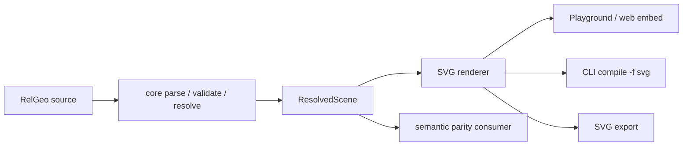

# Expected SVG Renderer Capability Catalog

**Status:** expected catalog synchronized with the current audit checkpoint;
row-level implementation status remains assigned by the downstream audit,
reconciliation, matrix, and backlog artifacts

**Tanggal katalog:** 2026-10-30 
**Compatibility line:** RelGeo DSL `0.5.x` 
**Owner keputusan dan katalog:** `relgeo/workspace` 
**Owner implementasi:** `relgeo/renderer-svg` 
**Runtime boundary:** resolved RelGeo scene → SVG string/markup untuk Node,
browser, CLI, Playground, dokumentasi, dan export ringan

**Current reconciliation:** 33 expected IDs; 26 `✔️`, 7 `🌗`, 0 `❌`, and 0
`⚠️`. The `➖` non-goals, `⏸️` deferred boolean expansion, and `?` environment
findings remain outside the expected implementation-row count. Current
row-level evidence, remaining gaps, owners, dependencies, and next actions are
maintained in the [implementation audit](./implementation-audit.md),
[reconciliation](./reconciliation.md), [capability matrix](./capability-matrix.md),
and [implementation-gap backlog](./implementation-gap-backlog.md).

## 1. Tujuan dan aturan baca

Dokumen ini menetapkan kemampuan yang **seharusnya tersedia** pada boundary
renderer SVG, termasuk kemampuan yang belum pernah diimplementasikan atau belum
memiliki evidence. Katalog disusun dari journey pengguna, target pengguna,
workflow produk, command surface, roadmap, kontrak DSL, compatibility policy,
keputusan scope, dan provenance fixture.

Katalog ini adalah prerequisite untuk audit. Setiap row memiliki:

- ID stabil;
- user outcome;
- dasar requirement;
- keputusan scope;
- owner/source of truth; dan
- status verifikasi katalog.

`PENDING-AUDIT` pada kolom terakhir adalah provenance marker dari expected-set,
bukan row-level implementation status. The downstream audit has now compared
all 33 IDs with source, tests, fixtures, consumers, and environment evidence;
the resulting status symbols, evidence, remaining gaps, owners, dependencies,
and next actions live in the linked downstream artifacts. This catalog keeps
the expected IDs and does not delete unresolved, deferred, or unverified scope.

Aturan pemisahan sumber:

- `spec/id/` menentukan makna normatif DSL dan semantic scene yang diterima
  renderer;
- master plan, plan 07, README consumer, compatibility policy, dan fixture
  manifest menentukan workflow, boundary, keputusan, dan provenance;
- kode `renderer-svg/` serta matrix/audit lama **bukan sumber daftar awal**.
  Keduanya baru boleh dipakai pada task audit setelah katalog ini disepakati.

## 2. Target pengguna dan expected journey

Katalog ini melayani:

- author gambar parametrik dan technical drawing;
- reviewer yang memeriksa identity, geometry, role, metadata, dan diagnostics;
- pengguna Playground browser untuk loop edit → resolve → preview → inspect;
- pengguna CLI/shell/CI untuk compile, check, dan export SVG; dan
- integrator Node/browser yang memakai `@relgeo/renderer-svg` bersama resolved
  scene dari `@relgeo/core`.

Journey minimum yang membentuk boundary renderer:

| Consumer workflow | Expected renderer outcome |
| --- | --- |
| Playground edit → resolve → preview → inspect | Render resolved scene quickly, fit it to a viewport, preserve IDs/metadata needed by inspection, and tolerate a separate diagnostic state without pretending invalid source resolved successfully. |
| CLI `compile <file> -f svg` | Convert an already resolved scene into deterministic SVG suitable for stdout or file output. |
| CLI `compile <file> -f svg --sheet <id>` | Render the selected sheet/view composition with its declared placement and page presentation. |
| Node integration | Import a public renderer API, pass a resolved scene, and receive SVG without requiring a browser DOM. |
| Browser integration | Embed the returned SVG or insert it into a DOM safely, with no executable markup from source-controlled or user-controlled strings. |
| Flutter semantic parity | Compare object identity, kind, primitive/path topology, endpoints, rings, and geometry at the approved semantic boundary; do not require raw SVG byte equality. |

### 2.1 Surface, command, and menu ownership

The renderer has no top-level menu of its own. Its expected capability is
reached through the following command and UI surfaces; command routing and UI
state remain owned by the consumer:

| Surface | User-facing command/menu/affordance | Renderer responsibility | Consumer owner/source |
| --- | --- | --- | --- |
| CLI | `compile <file> -f svg` | Render the resolved scene to deterministic SVG for stdout or file output. | `cli/README.md` (`Compile to SVG`, `compile <file>`) |
| CLI | `compile <file> -f svg --sheet <id>` | Render the selected sheet/view composition and return an explicit missing-target outcome. | `cli/README.md` (`Compile a Specific Sheet to SVG`) |
| Playground | edit → resolve → preview → inspect; model preview and sheet/print-oriented affordance | Render the current resolved scene and expose the configured inspection projection; do not own editor menus or diagnostics state. | `playground/README.md`; `docs/plans/05-public-docs-and-playground-hardening.md` |
| Node/browser package | import `@relgeo/renderer-svg` and call the public render entrypoint | Accept a resolved scene and return embeddable SVG without requiring a DOM. | `renderer-svg/README.md`; `docs/REPOSITORY-MAP.md` |
| Conformance/parity workflow | active, legacy, invalid, runtime-diagnostic, runtime-error, and candidate fixture runs | Produce the renderer projection used by the approved semantic comparator; do not promote fixture status implicitly. | `fixtures/manifest.json`; `docs/plans/07-flutter-capability-promotion-and-svg-parity.md` |

This ownership boundary is part of the expected catalog: a missing CLI or
Playground command is a consumer integration gap, while a missing projection
or unsafe serialization is an SVG renderer gap. Both remain expected rows for
the downstream audit rather than being silently omitted.

## 3. Requirement register

| Code | Requirement / decision | Source of truth |
| --- | --- | --- |
| `R-JOURNEY` | RelGeo is a relation-first, declarative geometry workflow whose resolved scene is previewed, inspected, compiled, and exported. | `README.md`; `playground/README.md`; `cli/README.md`; `docs/plans/05-public-docs-and-playground-hardening.md` |
| `R-BOUNDARY` | Renderer consumes `ResolvedScene`; parsing, validation, dependency resolution, and geometry meaning remain outside renderer ownership. | `renderer-svg/README.md`; `docs/MATURATION-MASTER-PLAN.md` §2.1–§2.3; `spec/id/core/` |
| `R-SCENE` | Objects have stable identity, explicit type, deterministic resolved result, geometry, anchors, transforms, composition, collections, and metadata. | `spec/id/geometry/13-object-model.md`–`20-geometry-queries.md`; `spec/id/core/05-semantic-guarantees.md` |
| `R-PRIMITIVE` | Resolved geometry and presentation objects have a renderer projection that preserves their semantic kind and geometry. | `spec/id/geometry/14-geometry-objects.md`; `spec/id/presentation/22-dimension.md`; `spec/id/presentation/23-annotation.md` |
| `R-COMPOSITION` | Group, clone, component, collection, operation, view, and sheet composition remain addressable and renderable without changing model semantics. | `spec/id/geometry/15-composition-objects.md`; `spec/id/geometry/16-collection-objects.md`; `spec/id/presentation/25-views-sheets.md` |
| `R-PRESENTATION` | Role, visibility, metadata, styles, dimensions, annotations, and sheet presentation are renderer-facing output policy; they must not silently mutate geometry. | `spec/id/presentation/22-dimension.md`–`26-metadata.md`; `docs/decisions/08-boolean-intersection-contract-review.md` §11 |
| `R-PARITY` | SVG semantic parity is layered: geometry/identity is core; selected metadata or diagnostics may become separate presentation contracts when a consumer needs them. | `docs/plans/07-flutter-capability-promotion-and-svg-parity.md` §2, §7; `docs/decisions/07-cross-repo-open-decisions.md` §5; `docs/decisions/08-boolean-intersection-contract-review.md` §11 |
| `R-BOUNDS` | Scene bbox, padding, orientation, origin, viewBox, dimensions, and optional physical/export context produce a usable viewport. | `spec/id/core/03-scene.md`; `spec/id/presentation/25-views-sheets.md`; `renderer-svg/README.md` |
| `R-DETERMINISM` | Same resolved input and options produce stable object ordering, IDs, collection order, geometry serialization, and semantic projection. | `spec/id/core/05-semantic-guarantees.md`; `spec/id/geometry/19-collections.md`; `docs/MATURATION-MASTER-PLAN.md` §2.5 |
| `R-ERROR` | Invalid renderer options, missing sheet/view, unsupported resolved shape, and unsafe values fail or degrade through explicit, deterministic boundaries. | `spec/id/core/06-error-model.md`; `spec/id/presentation/25-views-sheets.md` §25.5; `fixtures/manifest.json` invalid/runtime entries |
| `R-SECURITY` | XML/text/attribute values are escaped and output cannot introduce executable SVG markup when source metadata is untrusted. | `docs/plans/07-flutter-capability-promotion-and-svg-parity.md` §7; fixture `sheet-xml-escaping`; repository public-surface policy in `docs/MATURATION-MASTER-PLAN.md` §2.2 |
| `R-EXPORT` | Renderer output can be consumed as an embeddable SVG string for web/docs and lightweight file export; serialization details are not a universal byte contract. | `renderer-svg/README.md`; `cli/README.md`; `docs/decisions/07-cross-repo-open-decisions.md` §5 |
| `R-COMPAT` | Active line is DSL `0.5`; supported legacy fixtures remain explicit, unsupported future versions fail upstream, and renderer claims follow the active compatibility line. | `docs/compatibility-matrix.json`; `fixtures/manifest.json`; `docs/plans/02-contract-versioning.md`; `renderer-svg/README.md` |
| `R-FIXTURE` | Shared fixtures distinguish active, supported-legacy, invalid, runtime-diagnostic, runtime-error, and capability evidence; fixture status is not inferred from implementation presence. | `fixtures/manifest.json`; `docs/MATURATION-MASTER-PLAN.md` Tahap 4 dan Tahap 6 |
| `R-CONSUMER` | Renderer is a reusable public package consumed at explicit boundaries by core, CLI, Playground, Markdown/docs, browser, and semantic-parity workflows. | `renderer-svg/README.md`; `cli/README.md`; `playground/README.md`; `docs/REPOSITORY-MAP.md` |

## 4. Scope decisions

### In scope

- public resolved-scene-to-SVG API and render options;
- scene rendering from an already resolved scene, including empty-scene and
  root-SVG behavior;
- scene root, viewport, bbox, padding, origin/orientation, dimensions, and
  viewBox policy;
- primitive, path, topology, composition, transform, collection, layer/role,
  style, metadata, dimension, annotation, view, and sheet projection;
- deterministic identity/order/serialization and semantic projection;
- explicit error handling and no-executable-markup boundary;
- Node-safe and browser-embeddable use;
- CLI, Playground, fixture/conformance, export, and approved semantic parity
  consumer integration boundaries.

### In scope with an explicit boundary

- semantic parity covers identity, object kind, primitive/path topology,
  endpoints, rings, and geometry with documented tolerance;
- `data-*` metadata and diagnostic overlays are expected renderer surfaces but
  become cross-consumer contracts only when a consumer-specific fixture and
  decision promote them;
- boolean/intersection is expected only at the promotion boundary explicitly
  approved by Decision 08: line-line intersection and rectangle
  `intersect`/`subtract`, with declared empty/multipart error behavior;
- styles, text metrics, viewBox policy, and sheet presentation may be
  surface-specific unless a separate acceptance contract exists.

### Out of scope for this catalog

- parsing source DSL, validation, dependency resolution, or geometry solving;
- becoming a generic SVG editor or a second semantic geometry engine;
- universal raw SVG byte-for-byte parity, attribute order, whitespace, or path
  formatting as product contract;
- broad boolean `union`, `xor`, non-rectangle operands, degenerate input, or
  topology expansion outside the approved promotion boundary;
- exact cross-runtime font metrics, line wrapping, and typography parity;
- Flutter workbench ownership, package publishing/release automation, desktop
  distribution, and native accessibility evidence.

## 5. Expected capability catalog

All rows below retain `PENDING-AUDIT` by design as the catalog's expected-set
marker. The current audit preserves these IDs and adds implementation evidence,
parity, and gap status in downstream artifacts rather than rewriting the
expected set.

### A. Public boundary and scene root

| ID | Capability | User outcome | Dasar requirement | Scope decision | Owner / source of truth | Status verifikasi |
| --- | --- | --- | --- | --- | --- | --- |
| `SVG-API-001` | Expose a documented public renderer entrypoint that accepts a resolved scene and render options and returns SVG markup. | Node, CLI, and browser integrators can render without private internals. | `R-BOUNDARY`, `R-EXPORT`, `R-CONSUMER` | **IN**; resolved scene is the input boundary. | `relgeo/renderer-svg`; `renderer-svg/README.md`; package public API contract | `PENDING-AUDIT` |
| `SVG-API-002` | Keep the renderer usable in Node without requiring a browser DOM, while allowing the returned SVG to be embedded in a browser. | Server-side export and browser preview share one renderer surface. | `R-JOURNEY`, `R-EXPORT`, `R-CONSUMER` | **IN**; DOM insertion belongs to the host consumer. | `relgeo/renderer-svg`; `renderer-svg/README.md`; `cli/README.md`; `playground/README.md` | `PENDING-AUDIT` |
| `SVG-SCENE-001` | Emit a valid SVG root and a stable empty-scene result when no renderable objects are present. | Empty or temporarily incomplete scenes have a predictable render boundary. | `R-BOUNDS`, `R-ERROR`, `R-EXPORT` | **IN**; empty output must remain valid and deterministic. | `relgeo/renderer-svg`; `spec/id/core/03-scene.md` | `PENDING-AUDIT` |
| `SVG-SCENE-002` | Derive viewport/viewBox from resolved scene bounds, configured padding, origin, and orientation. | Preview and export show the whole scene with predictable coordinates. | `R-BOUNDS`, `R-SCENE` | **IN**; bbox semantics come from resolved scene, not renderer geometry solving. | `relgeo/renderer-svg`; `spec/id/core/03-scene.md`; `renderer-svg/README.md` | `PENDING-AUDIT` |
| `SVG-SCENE-003` | Emit width/height and optional physical/export dimensions according to the selected render context without changing semantic geometry. | SVG can be displayed, printed, or exported at the intended surface size. | `R-BOUNDS`, `R-EXPORT`, `R-PRESENTATION` | **IN WITH BOUNDARY**; exact browser layout policy remains host-specific. | `relgeo/renderer-svg`; `spec/id/presentation/25-views-sheets.md`; `docs/decisions/08-boolean-intersection-contract-review.md` §11 | `PENDING-AUDIT` |

### B. Primitive and semantic geometry projection

| ID | Capability | User outcome | Dasar requirement | Scope decision | Owner / source of truth | Status verifikasi |
| --- | --- | --- | --- | --- | --- | --- |
| `SVG-PRIM-001` | Project point and line objects, including endpoints and point display policy, into SVG elements. | Basic construction geometry remains visible and inspectable. | `R-PRIMITIVE`, `R-SCENE` | **IN**; point styling is presentation, point coordinates are semantic. | `relgeo/spec`; `spec/id/geometry/14-geometry-objects.md` | `PENDING-AUDIT` |
| `SVG-PRIM-002` | Project rect, circle, and ellipse objects with their resolved dimensions, centers, and radii. | Common closed primitives render with their declared shape and scale. | `R-PRIMITIVE`, `R-SCENE` | **IN**; renderer does not recompute dimensions from source. | `relgeo/spec`; `spec/id/geometry/14-geometry-objects.md` | `PENDING-AUDIT` |
| `SVG-PRIM-003` | Project arc, quadratic, and cubic curve objects while preserving control/endpoint geometry. | Curved geometry renders without flattening its semantic path unexpectedly. | `R-PRIMITIVE`, `R-PARITY` | **IN**; numeric serialization may differ while semantic geometry remains comparable. | `relgeo/spec`; `spec/id/geometry/14-geometry-objects.md` | `PENDING-AUDIT` |
| `SVG-PRIM-004` | Project polygon and text objects with stable identity and semantic placement. | Closed polygons and labels remain available to preview, inspection, and export. | `R-PRIMITIVE`, `R-PRESENTATION` | **IN**; exact font metrics are not universal parity. | `relgeo/spec`; `spec/id/geometry/14-geometry-objects.md`; `spec/id/presentation/23-annotation.md` | `PENDING-AUDIT` |
| `SVG-PATH-001` | Project open/closed paths, subpaths, closure, islands, holes, and fill-rule semantics. | Complex geometry and cutouts preserve topology in SVG. | `R-PRIMITIVE`, `R-PARITY`, `R-DETERMINISM` | **IN**; topology meaning is resolved upstream, renderer projects it. | `relgeo/spec`; `spec/id/geometry/14-geometry-objects.md`, `16-collection-objects.md`; `docs/plans/07-flutter-capability-promotion-and-svg-parity.md` §7 | `PENDING-AUDIT` |
| `SVG-BOOLEAN-001` | Project the approved boolean/intersection boundary: line-line intersection and rectangle `intersect`/`subtract`, including holes and declared result shape. | The promoted capability has a stable SVG surface across TypeScript, CLI, Playground, and Flutter semantic comparison. | `R-PARITY`, `R-FIXTURE`, `R-SCENE` | **IN WITH BOUNDARY**; only Decision 08 scope is active. | `relgeo/workspace`; `docs/decisions/08-boolean-intersection-contract-review.md`; `fixtures/manifest.json` fixture `v05-boolean-intersection-candidate` | `PENDING-AUDIT` |
| `SVG-BOOLEAN-002` | Preserve explicit empty/multipart boolean failure semantics at the render boundary when upstream resolution reports them. | Consumers see a stable error/diagnostic outcome instead of a misleading SVG. | `R-ERROR`, `R-PARITY`, `R-FIXTURE` | **IN WITH BOUNDARY**; renderer must not broaden the operation contract. | `relgeo/spec`; `docs/decisions/08-boolean-intersection-contract-review.md` §3.3; fixtures `v05-runtime-empty-boolean`, `v05-runtime-multipart-boolean` | `PENDING-AUDIT` |

### C. Composition, transforms, and layers

| ID | Capability | User outcome | Dasar requirement | Scope decision | Owner / source of truth | Status verifikasi |
| --- | --- | --- | --- | --- | --- | --- |
| `SVG-COMP-001` | Render group, clone, component, and nested composition recursively while preserving object identity and parent/child structure. | Reusable drawing rules render as one coherent scene and remain inspectable. | `R-COMPOSITION`, `R-SCENE` | **IN**; composition is consumed from resolved scene. | `relgeo/spec`; `spec/id/geometry/15-composition-objects.md` | `PENDING-AUDIT` |
| `SVG-COMP-002` | Render collection wrappers and their resolved children with stable ordering and IDs. | Repeated, divided, split, and multi-result outputs remain addressable. | `R-COMPOSITION`, `R-DETERMINISM` | **IN WITH BOUNDARY**; collection semantics remain core-owned. | `relgeo/spec`; `spec/id/geometry/16-collection-objects.md`, `19-collections.md` | `PENDING-AUDIT` |
| `SVG-TRANS-001` | Apply resolved translate, rotate, scale, mirror, and object transform chains in the declared stable order. | Users can place and reuse geometry without manually rewriting coordinates. | `R-COMPOSITION`, `R-SCENE`, `R-DETERMINISM` | **IN**; renderer applies resolved transforms and does not infer new geometry relations. | `relgeo/spec`; `spec/id/geometry/13-object-model.md`, `15-composition-objects.md`, `17-placement.md` | `PENDING-AUDIT` |
| `SVG-LAYER-001` | Apply role/visibility filtering and preserve final-output role defaults for `final`, `construction`, `guide`, `dimension`, `annotation`, `centerline`, `hidden`, `section`, `cut`, and `fold`. | Preview/export can show the intended drawing layers without changing model geometry. | `R-PRESENTATION`, `R-COMPOSITION` | **IN**; filter is a render option/presentation policy. | `relgeo/spec`; `spec/id/presentation/24-drawing-roles.md`, `26-metadata.md` | `PENDING-AUDIT` |
| `SVG-LAYER-002` | Provide optional inspection hooks for IDs, labels, anchors, bounds, and segment/topology context without making overlays part of core geometry. | Playground and tooling can inspect a scene visually. | `R-JOURNEY`, `R-PRESENTATION`, `R-CONSUMER` | **IN WITH BOUNDARY**; overlay visibility is consumer/render-option policy. | `playground/README.md`; `docs/plans/05-public-docs-and-playground-hardening.md`; `spec/id/geometry/18-anchors.md` | `PENDING-AUDIT` |

### D. Styles and semantic metadata

| ID | Capability | User outcome | Dasar requirement | Scope decision | Owner / source of truth | Status verifikasi |
| --- | --- | --- | --- | --- | --- | --- |
| `SVG-STYLE-001` | Project resolved stroke, fill, stroke width, opacity, dash, and role defaults into safe SVG presentation attributes. | Final output is legible and respects explicit author/role presentation intent. | `R-PRESENTATION`, `R-SCENE` | **IN**; style is presentation and must not redefine geometry. | `relgeo/spec`; `spec/id/presentation/24-drawing-roles.md`, `26-metadata.md` | `PENDING-AUDIT` |
| `SVG-STYLE-002` | Project text/font/arrow presentation for text, dimension, and annotation objects with stable renderer-local fallback policy. | Labels and drafting annotations remain readable when optional style fields are absent. | `R-PRESENTATION`, `R-BOUNDS` | **IN WITH BOUNDARY**; exact font metrics and typography parity are surface-specific. | `relgeo/spec`; `spec/id/presentation/22-dimension.md`, `23-annotation.md`; `docs/decisions/08-boolean-intersection-contract-review.md` §11 | `PENDING-AUDIT` |
| `SVG-META-001` | Project selected resolved metadata such as role, intent, label, and preset/style identity to inspection-safe `data-*` or equivalent attributes. | Inspectors and external tools can locate semantic intent without parsing visual styles. | `R-PRESENTATION`, `R-CONSUMER`, `R-PARITY` | **IN WITH BOUNDARY**; only promoted metadata becomes cross-consumer contract. | `renderer-svg/README.md`; `spec/id/presentation/26-metadata.md`; `docs/decisions/08-boolean-intersection-contract-review.md` §11 | `PENDING-AUDIT` |
| `SVG-META-002` | Keep metadata non-authoritative: removing presentation metadata does not change resolved geometry or object identity. | Styling/inspection changes cannot silently alter the model. | `R-PRESENTATION`, `R-SCENE` | **IN**; metadata is downstream projection only. | `spec/id/presentation/26-metadata.md` | `PENDING-AUDIT` |

### E. Dimensions, annotations, views, and sheets

| ID | Capability | User outcome | Dasar requirement | Scope decision | Owner / source of truth | Status verifikasi |
| --- | --- | --- | --- | --- | --- | --- |
| `SVG-DIM-001` | Render linear, radius, diameter, and angular dimensions with extension/leader geometry and stable labels. | Technical-drawing users can communicate measurements in exported SVG. | `R-PRIMITIVE`, `R-PRESENTATION` | **IN**; dimensions are annotation-layer objects, not core geometry. | `spec/id/presentation/22-dimension.md` | `PENDING-AUDIT` |
| `SVG-ANNOT-001` | Render annotations with text, target/leader references, placement, multiline order, and stable fallback placement. | Review notes and drafting callouts remain visible and attached to their targets. | `R-PRIMITIVE`, `R-PRESENTATION`, `R-SCENE` | **IN**; exact text metrics remain renderer-local/surface-specific. | `spec/id/presentation/23-annotation.md` | `PENDING-AUDIT` |
| `SVG-SHEET-001` | Render a selected view/sheet with declared placement, scale, page border, title block, and standard/custom size. | CLI and print-oriented workflows can export a composed drawing sheet. | `R-COMPOSITION`, `R-BOUNDS`, `R-EXPORT` | **IN WITH BOUNDARY**; sheet is a composition/render layer and does not mutate model geometry. | `spec/id/presentation/25-views-sheets.md`; `cli/README.md` | `PENDING-AUDIT` |
| `SVG-SHEET-002` | Select a requested sheet deterministically and report missing/invalid sheet or view references explicitly. | Users receive a useful failure instead of a silently wrong page. | `R-ERROR`, `R-COMPOSITION` | **IN**; error codes and semantic ownership remain aligned with spec/core. | `spec/id/presentation/25-views-sheets.md` §25.5; `spec/id/core/06-error-model.md` | `PENDING-AUDIT` |

### F. Determinism, error, security, and delivery boundary

| ID | Capability | User outcome | Dasar requirement | Scope decision | Owner / source of truth | Status verifikasi |
| --- | --- | --- | --- | --- | --- | --- |
| `SVG-DET-001` | Produce deterministic root/object order, identity/ID mapping, collection projection, and numeric serialization for the same resolved scene and options. | Snapshots, exports, and reviews are reproducible. | `R-DETERMINISM`, `R-PARITY`, `R-FIXTURE` | **IN**; deterministic does not mean byte equality across unrelated renderers. | `spec/id/core/05-semantic-guarantees.md`; `spec/id/geometry/19-collections.md`; `docs/plans/07-flutter-capability-promotion-and-svg-parity.md` §2 | `PENDING-AUDIT` |
| `SVG-ERR-001` | Distinguish empty scene, unsupported/malformed render input, missing composition target, missing sheet/view, and upstream runtime diagnostics with stable behavior. | CLI, Playground, and integrators can recover or report the right failure class. | `R-ERROR`, `R-CONSUMER`, `R-FIXTURE` | **IN**; renderer must not swallow semantic failures or invent repairs. | `spec/id/core/06-error-model.md`; `fixtures/manifest.json`; `renderer-svg/README.md` | `PENDING-AUDIT` |
| `SVG-SEC-001` | Escape XML/text/attribute values for IDs, metadata, styles, labels, dimensions, and annotations and reject/neutralize executable SVG payloads. | Untrusted or user-authored strings cannot become scriptable markup in browser output. | `R-SECURITY`, `R-ERROR` | **IN**; security boundary applies to every dynamic SVG string. | `docs/MATURATION-MASTER-PLAN.md` §2.2; `docs/plans/07-flutter-capability-promotion-and-svg-parity.md` §7; fixture `sheet-xml-escaping` | `PENDING-AUDIT` |
| `SVG-EXPORT-001` | Return self-contained embeddable SVG markup suitable for stdout, file output, docs, and lightweight web export without claiming a universal raw-byte contract. | Consumers can persist or embed output while semantic comparison stays meaningful. | `R-EXPORT`, `R-PARITY` | **IN**; whitespace, attribute order, marker implementation, and path formatting remain implementation details. | `renderer-svg/README.md`; `cli/README.md`; `docs/decisions/07-cross-repo-open-decisions.md` §5 | `PENDING-AUDIT` |
| `SVG-INTEG-001` | Support the CLI compile-to-SVG and selected-sheet workflows at the renderer boundary. | Terminal users can validate/compile/export without opening a UI. | `R-JOURNEY`, `R-CONSUMER`, `R-EXPORT` | **IN WITH BOUNDARY**; CLI owns command parsing and file I/O, renderer owns SVG projection. | `cli/README.md`; `docs/REPOSITORY-MAP.md`; `renderer-svg/README.md` | `PENDING-AUDIT` |
| `SVG-INTEG-002` | Support Playground worker → renderer → browser DOM preview, including model/sheet preview options and inspection hooks. | Browser users can see a current preview and inspect the resolved scene. | `R-JOURNEY`, `R-CONSUMER`, `R-PRESENTATION` | **IN WITH BOUNDARY**; browser runtime/e2e evidence is separate from renderer unit evidence. | `playground/README.md`; `docs/plans/05-public-docs-and-playground-hardening.md`; `docs/REPOSITORY-MAP.md` | `PENDING-AUDIT` |
| `SVG-INTEG-003` | Participate in shared fixture/conformance workflows for active, legacy, invalid, runtime-diagnostic, runtime-error, and capability cases without promoting capability status implicitly. | Cross-consumer regressions are visible at the agreed contract boundary. | `R-FIXTURE`, `R-COMPAT`, `R-PARITY` | **IN**; fixture status and promotion decisions remain workspace/maintainer-owned. | `fixtures/manifest.json`; `docs/plans/07-flutter-capability-promotion-and-svg-parity.md` | `PENDING-AUDIT` |
| `SVG-INTEG-004` | Expose semantic projection anchors usable by parity comparators without requiring raw SVG byte equality. | TypeScript and Flutter can prove the same approved scene meaning. | `R-PARITY`, `R-DETERMINISM` | **IN WITH BOUNDARY**; comparator/tolerance policy is a separate evidence layer. | `docs/decisions/07-cross-repo-open-decisions.md` §5; `docs/decisions/08-boolean-intersection-contract-review.md` §3, §6; plan 07 §7 | `PENDING-AUDIT` |

## 6. Verification contract for the downstream audit

The next audit task must retain every ID above and add separate columns for:

- implementation status (`implemented`, `partial`, `missing`, or `not applicable`);
- direct source/API evidence;
- test/fixture evidence and exact revision where available;
- consumer/platform evidence;
- parity status and gap/limitation;
- scope decision status (`in`, `held`, `out`, or `boundary`); and
- next action/owner.

The audit must not delete an expected capability merely because it is absent
from current code, an old matrix, or the current fixture set. A fixture marked
`capability` or `candidate` is evidence of a proposed boundary, not automatic
proof of active support. Missing service, dependency, browser, registry, or
platform evidence must remain `not verified`/`environment unavailable`, not be
converted into an implementation failure.

## 7. Catalog evidence index

Required evidence reviewed to construct this catalog:

- [Maturation master plan](../../MATURATION-MASTER-PLAN.md) — ecosystem ownership,
  compatibility line, source-of-truth rules, user-facing surfaces, and status
  semantics.
- [Repository map](../../REPOSITORY-MAP.md) — package ownership, renderer boundary,
  consumer boundaries, and the rule that command/menu ownership stays with CLI
  or Playground rather than the renderer package.
- [Compatibility matrix](../../compatibility-matrix.json) — compatibility and
  package/consumer boundary policy; not used as the initial capability list.
- [Plan 07 — Flutter capability promotion and SVG parity](../../plans/07-flutter-capability-promotion-and-svg-parity.md) — semantic parity policy,
  promotion boundary, presentation classification, and non-goals.
- [`renderer-svg/README.md`](../../../renderer-svg/README.md) — renderer package
  boundary, public use, consumers, and resolved-scene input contract.
- [`fixtures/manifest.json`](../../../fixtures/manifest.json) — fixture ownership,
  status vocabulary, active/legacy/error/candidate provenance, and consumer
  boundaries.
- [Normative geometry/presentation spec](../../../spec/id) — object model,
  primitives, composition, placement, metadata, roles, dimensions,
  annotations, views, and sheets.
- [Decision 07](../../decisions/07-cross-repo-open-decisions.md) and [Decision 08](../../decisions/08-boolean-intersection-contract-review.md) — accepted semantic parity and boolean/presentation scope decisions.

This document intentionally does not claim implementation coverage. That claim
belongs to the dependent audit and reconciliation tasks.
